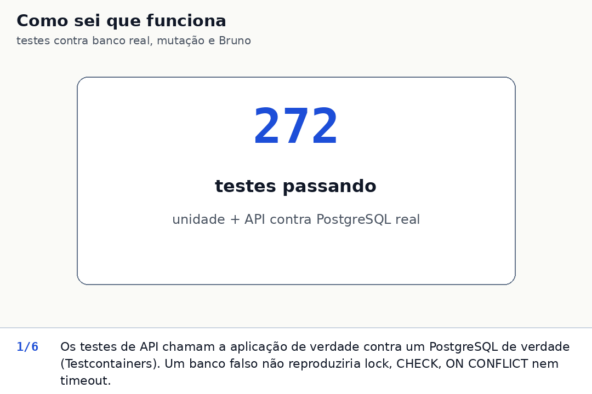
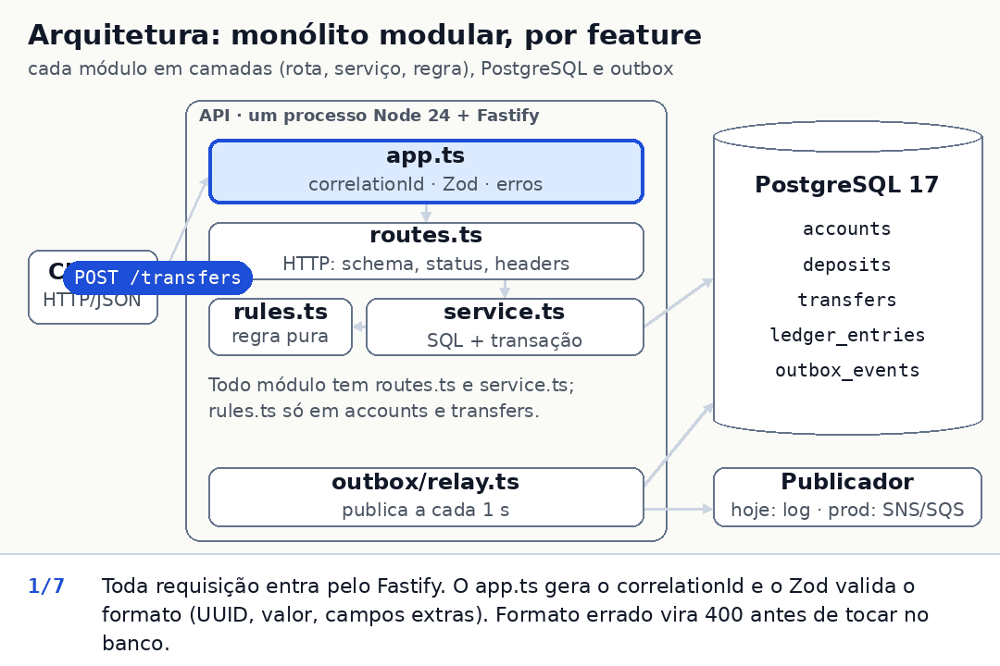
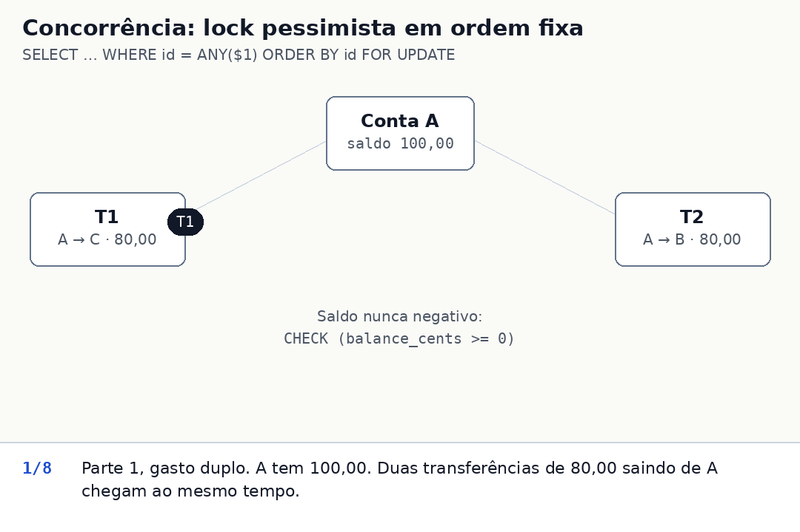
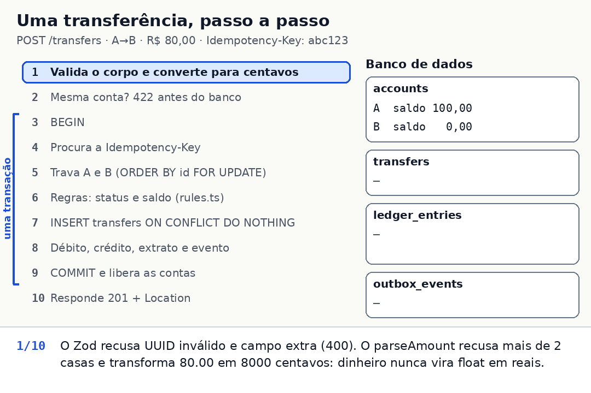
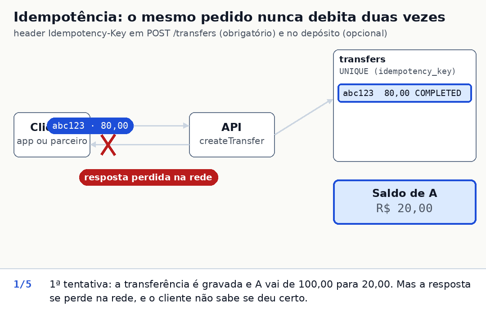
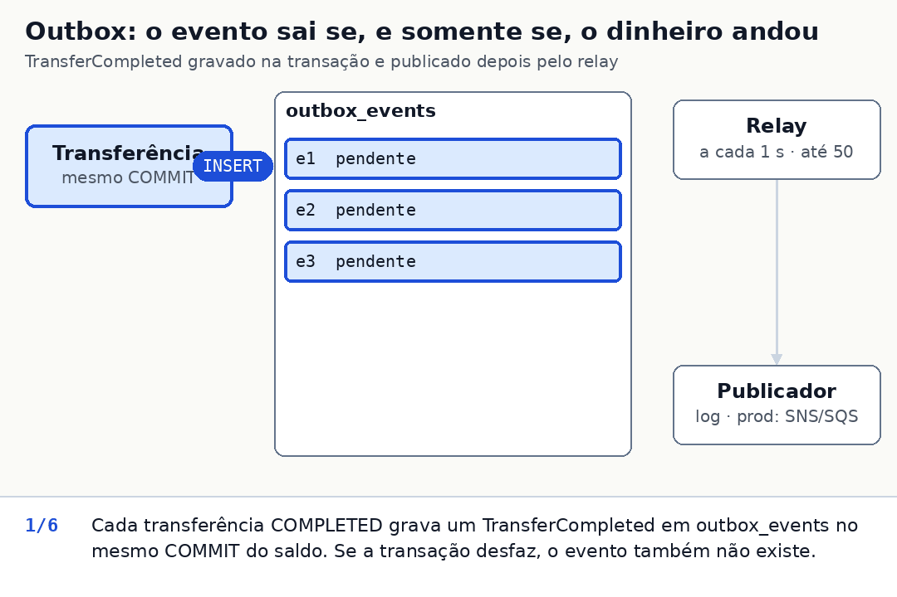
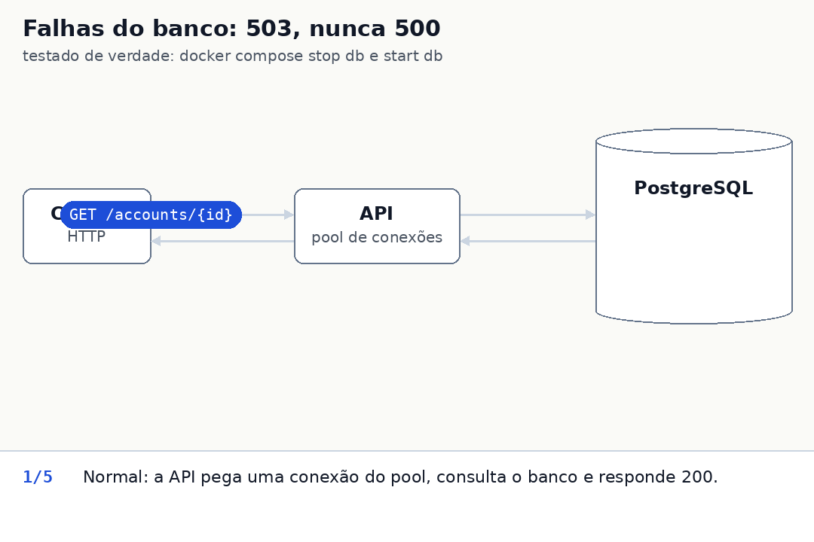
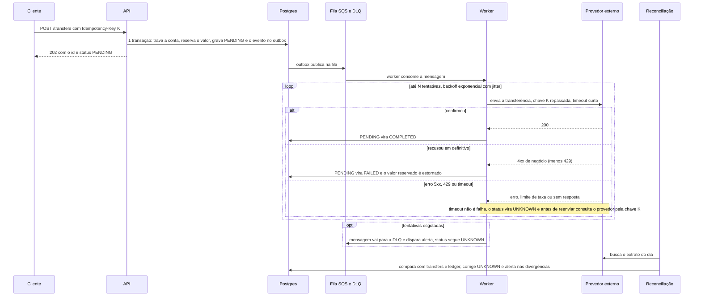

# Banking Transactions API

API REST de contas e movimentações financeiras: criar conta, bloquear/desbloquear/encerrar, depositar, transferir entre contas com idempotência, consultar transferência e extrato paginado. Foco: **saldo nunca negativo, nenhuma movimentação duplicada e tudo rastreável**, com o código mais simples que defenda isso.

Stack: Node 24 + TypeScript, Fastify 5, Zod 4, `pg` (SQL puro, sem ORM), PostgreSQL 17, Vitest + Testcontainers, Biome. Como a IA foi usada: [AI_USAGE.md](AI_USAGE.md).

## 1. Como rodar

Pré-requisito: Docker (Compose v2). Node 24 (o `.nvmrc` fixa a versão: `nvm use`) só é necessário para rodar testes e lint fora do container.

```bash
docker compose up --build   # ou: make up
```

Sobe a API e o PostgreSQL; as migrations rodam na inicialização, sem configuração manual. O comando fica em primeiro plano, com os logs no terminal (Ctrl+C para parar); com `-d` ele devolve o terminal e `docker compose logs -f api` acompanha. A API fica em http://localhost:3000, publicada só em 127.0.0.1 (não tem autenticação); Swagger UI em `/docs` (OpenAPI JSON em `/docs/json`); liveness em `/health` e readiness em `/ready`.

- Porta 3000 ocupada: `API_PORT=3400 docker compose up --build`. `POSTGRES_USER`, `POSTGRES_PASSWORD` e `POSTGRES_DB` também são variáveis do compose (veja `.env.example`).
- `make down` mantém o volume do banco. Para zerar os dados use `docker compose down -v`; isso também é necessário depois de mudar `POSTGRES_PASSWORD`, porque o Postgres só lê a senha na primeira inicialização.
- CI (`.github/workflows/ci.yml`): lint, build, testes, `docker build` e um smoke do compose em `/ready`.

Variáveis da API, todas com padrão exceto `DATABASE_URL` (obrigatória; o compose a define e repassa as demais, menos `PORT`): `PORT` (3000), `LOG_LEVEL` (info), `DB_POOL_MAX` (10), `DB_LOCK_TIMEOUT_MS` (5000), `DB_STATEMENT_TIMEOUT_MS` (15000), `DB_IDLE_IN_TX_TIMEOUT_MS` (30000), `OUTBOX_RELAY_ENABLED` (true; liga o relay do outbox nesta instância) e `OUTBOX_RELAY_INTERVAL_MS` (1000).

## 2. Testes

```bash
make test   # na primeira vez instala as dependências (npm ci); depois vitest, e o Testcontainers sobe um Postgres 17 descartável sozinho (precisa de Docker)
make lint   # Biome + tsc --noEmit (também instala as dependências se faltarem)
npm ci && npm test   # o mesmo sem make, com Node 24 (lint: npm run lint)
```

Os testes de API chamam a aplicação real (`app.inject`) contra um Postgres de verdade, não mocks: um banco em memória não reproduziria locks, `CHECK`, `ON CONFLICT` nem timeouts, que são justamente o que está em teste. Os testes de corrida da idempotência (transferência e depósito) e do relay forçam a sobreposição: seguram o lock até as requisições enfileirarem, esperando por `pg_blocking_pids` (no relay, por um portão), porque senão quase não se sobrepõem. Mutar o código confirma: sem o `ON CONFLICT` (em transferência e em depósito) ou sem o `SKIP LOCKED`, o teste correspondente falha. Quem rodou essas mutações durante o desenvolvimento foram agentes de IA, numa cópia do código, e li os resultados; qualquer um refaz tirando a cláusula e rodando o arquivo de teste ([AI_USAGE.md](AI_USAGE.md), item 5).

| Arquivo | O que prova |
|---|---|
| `test/unit/*.test.ts` | dinheiro: `0.1 + 0.2` e `1e-7` viram 400, zero e negativo 422 `INVALID_AMOUNT`, `1e15` e qualquer valor acima do teto 422 `AMOUNT_LIMIT_EXCEEDED`, o teto exato passa; contas: transições de status (CLOSED é terminal, mesmo status é no-op, não encerra com saldo), CPF/CNPJ só com dígitos ou a máscara canônica; transferência: origem não ativa, destino encerrado, saldo insuficiente, destino BLOCKED recebe; config: padrões, overrides por env e falha rápida sem `DATABASE_URL` |
| `test/api/foundation.test.ts` | `/health` e `/ready` (sem linha de log de requisição); envelope de erro (400/404/413/415/500/503) sem vazar mensagem interna nem o `detail` do `pg` no log; todo 4xx logado com `code` e `idempotencyKey` (só a válida; uma inválida vira `idempotencyKeyInvalid: true`, e o 5xx segue a mesma regra), nunca o corpo; URL mal codificada e parâmetro longo demais saem no envelope; cada código de conexão (`57P03`, `ENOTFOUND`, classe 08, `Connection terminated`...), cliente morto e `query_timeout` viram 503; pool esgotado vira 503 em vez de pendurar; `correlationId` aceito, gerado e presente no log; migrations idempotentes; timeouts de sessão em toda conexão; `BIGINT` volta como `number`; `withTransaction` faz commit e rollback |
| `test/db.test.ts` | `withTransaction` roda em `READ COMMITTED` mesmo com o padrão da sessão em `REPEATABLE READ`; backend morto no meio de uma transação: 503, o processo e o pool seguem vivos e o retry funciona; o erro de um client ocioso do pool não derruba o processo; o `idle_in_transaction_session_timeout` vem das opções; banco que para de responder: a transação desiste em `query_timeout` + 1 s e a conexão não volta ao pool com a transação aberta (o INSERT não é gravado) |
| `test/server.test.ts` | o processo de verdade (`src/server.ts`): com o banco fora, o boot escreve uma linha de log estruturada e sai com código 1; `SIGTERM` com uma requisição em andamento numa conexão keep-alive: a requisição termina com 201 e o processo sai com código 0 bem antes do prazo de 20 s |
| `test/api/accounts.test.ts` | criar/consultar/mudar status (mesmo status é 200 sem efeito); documento duplicado com e sem máscara; documento com espaços nas pontas aceito; 5 criações paralelas com o mesmo documento dão 1 × 201 e 4 × 409; nome com controle, bidi, U+FFFD ou sem letra, máscara inválida, UUID inválido, campo extra, JSON malformado e bytes UTF-8 inválidos são 400, nunca 500; `text/plain` é 415; logs `account created` e `account status changed` sem documento nem nome |
| `test/api/deposits.test.ts` | 10 depósitos de R$ 0,10 somam exatamente R$ 1,00; BLOCKED recebe, CLOSED recusa (422); idempotência do depósito, inclusive com o id da conta em maiúsculas, log `deposit processed` e 5 requisições paralelas com a mesma chave |
| `test/api/transfers.test.ts` | saldo de R$ 100 e transferência de R$ 150: 422, saldo continua R$ 100 e a tentativa fica `FAILED`; origem BLOCKED/CLOSED, destino CLOSED, mesma conta, conta inexistente (404); valor inválido não grava nada nem consome a chave; evento do outbox (com `correlationId`) só nas concluídas |
| `test/api/idempotency.test.ts` | retry com a mesma chave: um débito, mesma resposta, `Idempotent-Replayed: true`; `250` = `250.00` com os campos em outra ordem; outro valor, destino ou origem → 422; replay de `FAILED` continua `FAILED` mesmo depois de depositar; replay depois de bloquear a origem devolve o 201 original; 10 requisições paralelas com a mesma chave: uma movimentação, mesmo `id` |
| `test/api/concurrency.test.ts` | saldo de R$ 100 e duas transferências paralelas de R$ 80: só uma conclui; rajadas paralelas sem saldo negativo; A→B e B→A simultâneos sem deadlock; rajada aleatória entre 5 contas com saldo igual ao ledger; conta quente travada: 503 + `Retry-After`, e o retry com a mesma chave executa depois |
| `test/api/statement.test.ts` | ordem e `balanceAfter`; a resposta da movimentação e o extrato mostram o mesmo `createdAt` (também em SQL, depois de esperar um lock); `FAILED` não aparece; borda do período (`to=2026-09-10` inclui `23:59:59.999Z` e exclui `2026-09-11T00:00:00Z`); data, `limit` (só dígitos, 1–100, padrão 50) e `cursor` inválidos → 400; paginação sem duplicar; ordenação numérica do `id` na virada de dígitos; BLOCKED e CLOSED têm extrato |
| `test/api/openapi.test.ts`, `validation.test.ts` | `/docs/json` é OpenAPI 3 com todas as rotas; todo erro é um `$ref` para o único `ErrorEnvelope`; `amount` com descrição e exemplo e `holderName` sem `pattern`; `/docs` serve o Swagger UI; mensagem única da `Idempotency-Key` inválida ou ausente |
| `test/outbox.test.ts` | roda em banco próprio (o relay publica tudo que está pendente); publica uma vez; falha incrementa `attempts` e para ao chegar em `maxAttempts` (3 no teste; o padrão de produção é 10); falha vira log `warn` e evento parado vira `error`; a publicação que falha é tentada de novo só no próximo intervalo, não na hora; `last_error` truncado e sem NUL; dois relays concorrentes não publicam o mesmo evento (`SKIP LOCKED`); publicador mais lento que o `idle_in_transaction` derruba a rodada, não o processo; `startRelay` com parada limpa e backlog de vários lotes sem esperar um intervalo por lote |



## 3. Consumindo a API

Swagger UI em `/docs`, gerado dos mesmos schemas Zod que validam as requisições (não diverge do código). Dinheiro trafega como `number` em reais (`"amount": 250.00`) e datas em ISO 8601 UTC. Rotas: `POST /accounts`, `GET /accounts/{id}`, `PATCH /accounts/{id}/status`, `POST /accounts/{id}/deposits`, `POST /transfers`, `GET /transfers/{id}`, `GET /accounts/{id}/statement?from&to&limit&cursor`, `GET /health`, `GET /ready`. A pasta `bruno/` é uma coleção do [Bruno](https://www.usebruno.com) com todas elas (abra a pasta, escolha o ambiente `local` e rode a coleção em ordem: os requests passam ids de um para o outro por variáveis).

Roteiro com `curl` (bash ou zsh, não `sh`; precisa de `jq`; a API tem que estar no ar):

```bash
BASE=http://localhost:3000   # outra porta se subiu com API_PORT (seção 1)
JSON='content-type: application/json'
# 1. duas contas; RUN deixa documentos e chaves únicos (a chave é global), então o roteiro pode rodar mais de uma vez
RUN=$RANDOM$RANDOM
DOC_A=$(printf '%011d' "${RUN}1"); DOC_B=$(printf '%011d' "${RUN}2")
A=$(curl -s -X POST $BASE/accounts -H "$JSON" -d "{\"holderName\":\"Ana Souza\",\"document\":\"$DOC_A\"}" | jq -r .id)
B=$(curl -s -X POST $BASE/accounts -H "$JSON" -d "{\"holderName\":\"Bruno Lima\",\"document\":\"$DOC_B\"}" | jq -r .id)
# 2. mesmo documento de novo -> 409 DOCUMENT_ALREADY_EXISTS
curl -s -X POST $BASE/accounts -H "$JSON" -d "{\"holderName\":\"Outra Ana\",\"document\":\"$DOC_A\"}"
# 3. depósito de R$ 500 em A -> 201; com chave, um retry depois de um 503 não credita duas vezes
curl -s -X POST $BASE/accounts/$A/deposits -H "$JSON" -H "Idempotency-Key: dep-$RUN" -d '{"amount":500.00}'
# 4. transferência A -> B de R$ 250 com a chave abc123-$RUN -> 201 COMPLETED (guarde o id)
BODY="{\"sourceAccountId\":\"$A\",\"destinationAccountId\":\"$B\",\"amount\":250.00}"
T=$(curl -s -X POST $BASE/transfers -H "$JSON" -H "Idempotency-Key: abc123-$RUN" -d "$BODY" | jq -r .id)
# 5. retry: mesma chave, mesmo payload (250 == 250.00) -> 201 igual + "Idempotent-Replayed: true"; saldo de A continua 250
curl -si -X POST $BASE/transfers -H "$JSON" -H "Idempotency-Key: abc123-$RUN" -d "${BODY/250.00/250}"
curl -s $BASE/accounts/$A
# 6. mesma chave, valor diferente -> 422 IDEMPOTENCY_KEY_REUSED
curl -s -X POST $BASE/transfers -H "$JSON" -H "Idempotency-Key: abc123-$RUN" -d "${BODY/250.00/100.00}"
# 7. saldo insuficiente -> 422 INSUFFICIENT_BALANCE com transferId; a tentativa fica registrada como FAILED
curl -s -X POST $BASE/transfers -H "$JSON" -H "Idempotency-Key: def456-$RUN" -d "${BODY/250.00/1000.00}"
# 8. consultar a transferência do passo 4
curl -s $BASE/transfers/$T
# 9. extrato de hoje (UTC), 1 item por página: a segunda chamada usa o nextCursor da primeira
TODAY=$(date -u +%F)
PAGE=$(curl -s "$BASE/accounts/$A/statement?from=$TODAY&to=$TODAY&limit=1"); echo "$PAGE"
curl -s "$BASE/accounts/$A/statement?from=$TODAY&to=$TODAY&limit=1&cursor=$(echo "$PAGE" | jq -r .nextCursor)"
# 10. bloquear A: não debita (422 SOURCE_ACCOUNT_NOT_ACTIVE), mas ainda recebe crédito (201)
curl -s -X PATCH $BASE/accounts/$A/status -H "$JSON" -d '{"status":"BLOCKED"}'
curl -s -X POST $BASE/transfers -H "$JSON" -H "Idempotency-Key: ghi789-$RUN" -d "${BODY/250.00/10.00}"
curl -s -X POST $BASE/accounts/$A/deposits -H "$JSON" -d '{"amount":10.00}'
# 11. entradas inválidas nunca viram 500
curl -s -X POST $BASE/transfers -H "$JSON" -H "Idempotency-Key: jkl012-$RUN" -d "${BODY/250.00/0.30000000000000004}"   # 400 (mais de 2 casas)
curl -s -X POST $BASE/accounts/$A/deposits -H "$JSON" -d '{"amount":-5}'                                               # 422 INVALID_AMOUNT
curl -s $BASE/accounts/nao-e-uuid                                                                                      # 400
curl -s -X POST $BASE/transfers -H "$JSON" -d "$BODY"                                                                  # 400 (sem Idempotency-Key)
# 12. rastrear: pelo correlation id (as linhas dessa requisição) e pelo transferId (`transfer processed`, o original e o replay; as linhas da consulta do passo 8; e, em até 1 s, `event published`)
curl -s -H 'x-correlation-id: demo-123' $BASE/accounts/$A
docker compose logs api | grep demo-123
docker compose logs api | grep "$T"
```

## 4. Decisões

### Estrutura: por feature, sem Clean/Hexagonal completo

`src/accounts/`, `transfers/`, `deposits/` e `statement/` têm `routes.ts` (HTTP e schema Zod de entrada, saída e OpenAPI) e `service.ts` (SQL e transação); só `accounts` e `transfers` têm `rules.ts` (regra de negócio sem I/O, testável sem banco). `outbox/relay.ts` é o relay de eventos, sem rotas. Na raiz de `src/`: `server.ts` (inicialização, relay e shutdown), `app.ts` (monta o Fastify: correlation id, erros, OpenAPI, módulos), `db.ts` (pool, `withTransaction`, migrations), `config.ts` (variáveis de ambiente) e `health.ts`; `src/shared/` tem `errors.ts`, `money.ts` e `schemas.ts`. O SQL do schema está em `migrations/001_init.sql`, editada no lugar durante o desenvolvimento porque nada foi implantado; depois de um deploy, toda mudança de schema entra como `002_*.sql` (o migrator só confere o nome do arquivo).

Por que não Clean/Hexagonal: o domínio cabe em 5 tabelas e a correção da transferência *depende* do SQL (lock, ordem, `CHECK`, `ON CONFLICT`). Portas e repositórios aqui só repassariam chamadas e esconderiam o trecho que a revisão precisa enxergar. A regra que muda com o negócio (saldo, status) fica isolada em `rules.ts`. Trade-off aceito: trocar de banco significa reescrever os `service.ts`; como a consistência vem de recursos do Postgres, a troca não seria mecânica de qualquer jeito. Dependências de runtime: `fastify`; `zod` + `fastify-type-provider-zod` (um schema só valida, tipa e gera o OpenAPI) com `@fastify/swagger` e `@fastify/swagger-ui` (o `/docs`); `pg`. Sem ORM, pelo mesmo motivo.



### Transações e concorrência

- **Uma transação por comando.** Toda escrita roda em `withTransaction` (BEGIN/COMMIT, ROLLBACK em qualquer erro): a transferência inteira vale ou nada vale. `GET` roda sem transação. Isolamento fixado no `BEGIN` (`ISOLATION LEVEL READ COMMITTED`): o re-read do `ON CONFLICT` depende de cada comando ter um snapshot novo, e sem isso, num banco com padrão `REPEATABLE READ`, toda corrida virava 503 (sem saldo errado, mas a API parava de funcionar sob concorrência). Os locks de linha já serializam o que importa.
- **Lock pessimista, ordem fixa.** As contas envolvidas são lidas com `SELECT ... ORDER BY id FOR UPDATE`. A→B e B→A pedem os locks **na mesma ordem**, então não há deadlock. Com o lock, o saldo lido é o real: duas transferências de R$ 80 com R$ 100 na conta executam em fila, e a segunda vê R$ 20 e é rejeitada. Com `lock_timeout` de 5 s, uma conta quente travada por outra transação falha com 503 + `Retry-After` em vez de pendurar a requisição (os outros limites: seção 5).
- **`CHECK (balance_cents >= 0)`** é a última defesa: se um bug futuro debitar a mais, o Postgres aborta a transação; saldo negativo nunca é gravado.

Por que não **otimista** (coluna `version`): em conta quente o conflito é o caso comum, não a exceção; cada colisão viraria erro + loop de retry na aplicação, mais código para o mesmo resultado. Por que não **SERIALIZABLE**: o Postgres aborta com `40001` sob conflito e a transação inteira precisa ser reexecutada, com falsos positivos por causa dos predicate locks; seria pagar retry e throughput para proteger o que `FOR UPDATE` já protege com uma cláusula. Custo do que escolhi: transferências da mesma conta são serializadas (seção 6).

Por que não a **operação atômica** que o enunciado lista (`UPDATE accounts SET balance_cents = balance_cents - $x WHERE id = $1 AND balance_cents >= $x AND status = 'ACTIVE'`, um round trip só): (1) uma transferência mexe em duas linhas, e dois `UPDATE`s A→B e B→A dão deadlock a menos que as linhas sejam travadas em ordem de `id`, que é o que o `FOR UPDATE` já faz; (2) o `UPDATE` diz *que* não debitou, não *por quê* (`INSUFFICIENT_BALANCE`, `SOURCE_ACCOUNT_NOT_ACTIVE`, conta inexistente), e a rejeição precisa ser persistida como `FAILED` com o motivo; (3) o status das duas contas (origem ativa, destino não encerrado) e o saldo precisam vir de uma leitura só e consistente, para o `balance_after_cents` de cada lançamento e a ordem do `id` do ledger valerem (extrato, abaixo). O `UPDATE` condicional bastaria para um débito numa conta só, sem destino; o ganho dele, menos idas ao banco com o lock preso, é a otimização que eu faria na conta quente (seção 6).



### Idempotência

**Fluxo de `POST /transfers`** (uma transação; é a ordem real do código):

1. Busca a chave. Se existe e o payload é equivalente, é replay; se o payload é diferente, 422 `IDEMPOTENCY_KEY_REUSED`.
2. Trava as duas contas (`ORDER BY id FOR UPDATE`); falta alguma: 404.
3. Aplica as regras e insere em `transfers` com `ON CONFLICT (idempotency_key) DO NOTHING`, já como `COMPLETED` ou `FAILED`.
4. Se o insert não devolveu linha, outra requisição com a mesma chave commitou antes: relê a chave e responde como no passo 1 (replay ou 422), nunca 500.
5. Só se `COMPLETED`: atualiza os dois saldos e grava os dois lançamentos do ledger e o evento do outbox.



Duas requisições simultâneas com a mesma chave caem no passo 4. Com as **mesmas contas**, a segunda espera o lock do passo 2 e devolve o resultado da primeira (coberto por teste: 10 em paralelo, uma movimentação). Com **contas diferentes** o resultado é 422 `IDEMPOTENCY_KEY_REUSED`: se não há conta em comum, não há disputa de lock e o `INSERT` da segunda espera a primeira terminar (índice `UNIQUE`); se há uma (A→B e A→C), a segunda espera o lock dela e cai no passo 4. Nunca 500 e nunca duas movimentações; o caso de contas diferentes decorre do `UNIQUE` e não tem teste dedicado.

Regras:

- **Chave:** `Idempotency-Key`, 1–255 caracteres ASCII visíveis. Não exige UUID (o enunciado usa `abc123`). Obrigatória em `POST /transfers`; opcional em depósito (sem chave, cada POST é um depósito novo; com chave, a mesma ordem de passos vale, sem o `FAILED`), mas **recomendo sempre enviá-la**: sem ela, um retry depois de um 503 pode creditar duas vezes (seção 5). `UNIQUE` no banco (`transfers`, `deposits`), escopo global; em produção seria por cliente autenticado.
- **Equivalência por campos normalizados**, não pelo corpo cru: origem, destino e valor em centavos (no depósito, conta e centavos). `250` e `250.00`, ou campos em outra ordem, são o mesmo payload; comparar o corpo cru faria um retry legítimo parecer "payload diferente".
- **Replay** devolve o mesmo status do original e `Idempotent-Replayed: true`: no 201, o mesmo corpo; na 422 de uma transferência `FAILED`, o mesmo status, `code` e `transferId` (o `timestamp` e o `correlationId` do envelope são os da nova requisição). Nunca reexecuta, mesmo que o mundo tenha mudado (conta bloqueada depois, saldo depositado depois).
- **Mesma chave, payload diferente → 422 `IDEMPOTENCY_KEY_REUSED`**, como no draft IETF `httpapi-idempotency-key-header`. Rejeitar é mais seguro que escolher qual das duas intenções vale; o cliente com um bug de reuso de chave descobre na hora.
- **Rejeição de negócio depois de travar as contas** (saldo insuficiente, origem não ativa, destino encerrado) é **persistida** como transferência `FAILED` e **consome a chave**: o retry devolve a mesma 422 com o mesmo `transferId`. Motivo: o retry precisa ser determinístico e auditável; sem gravar, o mesmo request daria 422 hoje e 201 amanhã. Quem quer tentar de novo usa **outra chave**. Custo assumido: o cliente que recebeu `INSUFFICIENT_BALANCE`, depositou e reenviou com a mesma chave continua recebendo a 422 original.
- **Não gravam nada nem consomem a chave:** 400, 404, `SAME_ACCOUNT`, `INVALID_AMOUNT`, `AMOUNT_LIMIT_EXCEEDED` e `IDEMPOTENCY_KEY_REUSED`. O depósito não tem estado `FAILED`: a rejeição (`ACCOUNT_CLOSED`) também não grava nada. O 503 normalmente não grava, mas **pode ter gravado**: seção 5, "503 e resultado incerto".
- **Sem expiração** neste escopo (TTL e limpeza: seção 8).



### Dinheiro em centavos

Saldo e valores são inteiros de centavos: `BIGINT` no banco, `number` seguro (`Number.isSafeInteger`) no TypeScript, nunca aritmética de float em reais. A conversão existe em um lugar só, `src/shared/money.ts`, e lê a representação decimal mais curta do número em vez de multiplicar o float por 100; assim `0.1 + 0.2` (`0.30000000000000004`) é rejeitado com 400 em vez de arredondado. O parser de `BIGINT` do `pg` lança se um valor passar de 2^53. Teto por operação: R$ 1.000.000.000,00. O JSON usa `number` em reais, como no enunciado. Trade-off: um cliente que some floats do lado dele ainda pode se confundir; a API só aceita e devolve valores com até 2 casas.

### Validação, status e erros

Regra de bolso: erro na **forma** do pedido (schema, JSON malformado, UUID inválido, mais de 2 casas, número JSON não finito como `1e999`, campo extra, `Idempotency-Key` ausente ou inválida, data, `limit` ou `cursor` inválidos) → **400 `VALIDATION_ERROR`**; item listado como **regra** de negócio no enunciado → **422** com o código da regra. Valor `<= 0` é 422 `INVALID_AMOUNT`; valor acima do teto (`1e15`, ou R$ 1.000.000.000,01) é 422 `AMOUNT_LIMIT_EXCEEDED`: o pedido está bem formado, só viola a regra.

Campos: `holderName` tem 1 a 120 caracteres depois do `trim`, sem caractere de controle, de direção de texto (bidi: U+202A a U+202E e U+2066 a U+2069, que falsificam como o nome aparece) nem U+FFFD, e com pelo menos uma letra. `document` é CPF ou CNPJ com 11 ou 14 dígitos puros ou na máscara canônica (`000.000.000-00`, `00.000.000/0000-00`); espaços nas pontas são removidos, é guardado só com dígitos e não tem os dígitos verificadores validados (o enunciado dispensa). Regras de conta: `BLOCKED` recebe crédito mas não debita; `CLOSED` não movimenta e é terminal; só se encerra conta com saldo zero. `PATCH .../status` com o status que a conta já tem é 200 sem efeito. Conta `CLOSED` continua reservando o documento (cadastrar o mesmo de novo é 409). Não há endpoint separado de encerramento: é `PATCH .../status` com `CLOSED`.

Todo erro tem o mesmo envelope: `{ code, message, timestamp, correlationId }`, mais `details` no 400 de schema e `transferId` na 422 de transferência persistida. Nunca stack trace, SQL ou mensagem do Postgres. Vale também para os erros do próprio Fastify (URL com percent-encoding inválido, parâmetro de caminho longo demais, JSON malformado, corpo grande). **Lacuna conhecida:** erros do parser HTTP (cabeçalhos grandes → 431, linha de requisição malformada) nunca chegam ao Fastify e saem no formato cru dele; cobrir isso pede um `clientErrorHandler` escrevendo HTTP à mão, com códigos que a API não define. O `/docs` mostra os status que cada rota devolve, não os valores de `code`; eles são estes:

| Status | `code` |
|---|---|
| 400 | `VALIDATION_ERROR` |
| 404 | `ACCOUNT_NOT_FOUND`, `TRANSFER_NOT_FOUND`, `ROUTE_NOT_FOUND` |
| 409 | `DOCUMENT_ALREADY_EXISTS` (inclusive em corrida) |
| 413, 415 | `PAYLOAD_TOO_LARGE` (corpo acima de 1 MB), `UNSUPPORTED_MEDIA_TYPE` (não é JSON) |
| 422 | `INVALID_AMOUNT`, `AMOUNT_LIMIT_EXCEEDED`, `SAME_ACCOUNT`, `SOURCE_ACCOUNT_NOT_ACTIVE`, `DESTINATION_ACCOUNT_CLOSED`, `INSUFFICIENT_BALANCE`, `ACCOUNT_CLOSED` (depositar numa conta encerrada ou reativá-la), `ACCOUNT_HAS_BALANCE` (encerrar com saldo), `IDEMPOTENCY_KEY_REUSED` |
| 500, 503 | `INTERNAL_ERROR`; `SERVICE_UNAVAILABLE` (só o 503 leva `Retry-After: 1`, sempre) |

### Extrato

Cada mudança de saldo é uma linha em `ledger_entries` com o `balance_after_cents` daquele momento e **o mesmo `created_at` da movimentação**: `transfers` e `deposits` gravam `created_at` com precisão de milissegundo (a de um `Date` do JS) e o ledger recebe esse valor de volta, então a resposta do POST, o `occurredAt` do evento e o extrato mostram o mesmo instante. O extrato é ordenado pelo `id` numérico do ledger (mais antigo primeiro), **não** por `created_at`: as linhas de uma conta só são inseridas com a conta travada, então a ordem do `id` é a ordem real em que o saldo mudou e bate com `balanceAfter`.

- **Cursor** (`nextCursor`) é o `id` da última linha em base64url, não um timestamp: o `timestamptz` do Postgres tem microssegundos e o `Date` do JS só milissegundos, e um cursor por `created_at` repetiria ou pularia linhas na virada da página. É opaco para o cliente, mas **não é assinado**: quem fabricar um cursor só escolhe de onde a lista recomeça, e como o SQL filtra por `account_id`, ele não lê linhas de outra conta; um valor fora do formato é 400.
- **Página:** `limit` de 1 a 100 (padrão 50, só dígitos); `nextCursor` é `null` na última. Transferências `FAILED` não aparecem (não movem saldo, não têm lançamento); contas `BLOCKED` e `CLOSED` continuam com extrato.
- **Período** em UTC, `from` e `to` opcionais, `to` inclusivo até `23:59:59.999Z`. Os limites são calculados no TypeScript como instantes UTC; `created_at >= $1::date` no SQL usaria o `TimeZone` da sessão e deslocaria o dia.

### Eventos: outbox

Uma transferência concluída grava, **na mesma transação**, um evento `TransferCompleted` em `outbox_events`: não existe transferência sem evento nem evento de transferência que não aconteceu (o "salvou no banco e caiu antes de publicar"). Payload:

```json
{ "eventId": "d682fed6-…", "eventType": "TransferCompleted", "transferId": "0f98c1b5-…",
  "sourceAccountId": "c65a080c-…", "destinationAccountId": "78e8c26b-…", "amount": 25.5,
  "occurredAt": "2026-10-30T21:26:55.090Z", "correlationId": "demo-123" }
```

Um relay dentro do processo da API lê até 50 pendentes por rodada e os entrega a um publicador, que neste escopo só escreve `event published` no log; marca `published_at` ao publicar e, em falha, incrementa `attempts`, guarda `last_error` e loga (`outbox publish failed` em warn; ao esgotar as tentativas, `outbox event parked` em error). Rodada com lote cheio é seguida de outra na hora, então um backlog drena sem esperar `OUTBOX_RELAY_INTERVAL_MS` por lote; com lote parcial, rodada que falhou ou publicação com erro ele espera o intervalo, para uma queda do broker não virar laço quente. Depois de 10 tentativas o evento para de ser tentado e fica à espera de alguém (como achar: seção 5); não há backoff por evento (com um broker de verdade eu usaria um `next_attempt_at` com backoff exponencial ou o retry e a DLQ nativos do SQS). Entrega **at least once**: o consumidor deduplica pelo `eventId`. O `correlationId` é o da requisição que executou a transferência (um replay não gera evento novo). O publicador real (SNS/SQS, Kafka) fica fora do escopo (seção 8).



## 5. Operação

**Logs.** JSON em stdout (pino). Cada linha de requisição tem `correlationId` (as do relay e da inicialização não): o header `x-correlation-id` é aceito se casar `^[A-Za-z0-9._-]{1,128}$`, senão a API gera um UUID; o valor volta no header da resposta e no envelope de erro. Linhas de negócio, em info: `account created` (`accountId`), `account status changed` (`accountId`, `from`, `to`, só quando o status mudou), `deposit processed` (`depositId`, `accountId`, `idempotencyKey`, `replayed`), `transfer processed` (`transferId`, `idempotencyKey`, `status`, `failureCode`, `replayed`) e `event published` (relay). Toda resposta 4xx gera `request rejected` com `code`, `statusCode` e `idempotencyKey`, e o 5xx gera `request failed` com a chave também; a chave só entra se for válida (1 a 255 ASCII visíveis), senão o log leva `idempotencyKeyInvalid: true` e nunca o header cru. Uma 422 se explica só pelos logs. `/health` e `/ready` não geram linha de requisição (o healthcheck bate a cada poucos segundos); só a falha aparece (`readiness check failed`). **Nunca** vão para o log o documento, o nome nem o corpo da requisição; o `detail` dos erros do `pg` (que pode conter o documento de uma violação de unicidade) é descartado.

**Como rastrear uma transferência.** O cliente tem o `correlationId` (header da resposta e do envelope de erro) ou o `transferId` (corpo, inclusive o da 422 persistida). `docker compose logs api | grep <correlationId>` mostra a requisição inteira, incluindo `transfer processed` e, depois, o `event published` (o evento carrega o mesmo `correlationId`); `grep <transferId>` acha o `transfer processed` e o `event published` pelo outro lado (mais as linhas de qualquer replay ou `GET /transfers/<id>`, que trazem o id): `correlationId` → linhas da requisição → `transferId` → `event published`. No banco, o rastro completo está em `transfers` (`WHERE idempotency_key = '<chave>'`), nos dois lançamentos de `ledger_entries` (`WHERE transfer_id = ...`) e no evento do outbox (`WHERE aggregate_id = ...`); acesso: `docker compose exec db psql -U banking`.

**`/health` vs `/ready`.** `/health` é liveness: responde 200 sem tocar o banco (o orquestrador só reinicia o processo se ele travar). `/ready` é readiness: executa `SELECT 1` e devolve 503 se o banco não responde (o balanceador tira a instância da rotação sem reiniciá-la).

**Timeouts e 503.** Nada espera para sempre:

| Onde | Limite | Resultado |
|---|---|---|
| esperar uma conexão livre do pool ou abrir uma nova | 5 s (fixo) | 503 |
| `lock_timeout` (conta quente travada) | 5 s (`DB_LOCK_TIMEOUT_MS`) | 503 |
| `statement_timeout` | 15 s (`DB_STATEMENT_TIMEOUT_MS`) | 503 |
| `query_timeout` do cliente (o banco não responde: congelado, sem reset de TCP) | `statement_timeout` + 5 s = 20 s (derivado, sem variável própria) | 503, a conexão é descartada |
| `ROLLBACK` depois de uma falha | 1 s (fixo) | se estourar, a conexão é destruída e nunca volta ao pool |
| `idle_in_transaction_session_timeout` | 30 s (`DB_IDLE_IN_TX_TIMEOUT_MS`) | o Postgres derruba a transação esquecida |
| requisição (cabeçalhos ou corpo) que não termina de chegar | `headersTimeout` e `requestTimeout` 30 s (fixos; o Node confere a cada 30 s, então o corte vem entre 30 e 60 s) | o Node responde 408, fora do envelope, e fecha a conexão |

O TCP keepalive começa depois de 10 s de silêncio. Banco congelado (`docker compose pause db`), medido numa conexão já aberta: 503 em 20 s numa leitura e em 21 s numa transferência (20 s do `query_timeout` + 1 s do `ROLLBACK`), sem reiniciar a API; ao voltar, ela responde sozinha. Com o pool frio (o `pg` fecha as conexões ociosas depois de 10 s), abrir uma conexão nova num banco congelado estoura os 5 s do pool e dá 503 em 5 s. Viram 503 com `Retry-After: 1`: os timeouts acima, deadlock (`40P01`), falha de serialização (`40001`), banco indisponível (`57P01`, `57P02`, `57P03`, `53300` e a classe `08`) e falhas de rede (`ECONNREFUSED`, `ECONNRESET`, `ENOTFOUND` quando o compose remove o DNS do banco parado, `EAI_AGAIN`, `ETIMEDOUT`, `EHOSTUNREACH`, `ENETUNREACH`, `EPIPE`), mais pool encerrado e cliente com a conexão já morta.

**Queda de conexão e shutdown.** Uma conexão que cai no meio de uma transação não derruba o processo: todo client em uso tem um listener de `error` (sem ele, um client morto em uso encerra o processo) e a requisição afetada recebe 503, o pool descarta o client e a próxima funciona. No compose a API e o banco têm `restart: unless-stopped`: a API volta sozinha se o processo cair ou sair no boot porque o banco não estava pronto (nesse caso ela loga uma linha estruturada e sai com código 1, e a política tenta de novo). Isto foi verificado durante o desenvolvimento por agentes de IA (quem implementou e a bancada de revisores), com `docker compose stop db` e `start db` sob carga, e li os resultados: tudo devolve 503 enquanto o banco está fora (`/health` segue 200) e a API volta a responder sozinha, em segundos, quando ele aceita conexões de novo. Em `SIGTERM`/`SIGINT` ela para o relay (esperando a rodada em andamento), para de aceitar conexões, espera as requisições em andamento, fecha cada conexão keep-alive assim que ela fica ociosa e fecha o pool, para não cortar uma transação no meio. Sem fechar as ociosas, o socket de uma requisição que termina durante o desligamento ficaria aberto pelos 72 s do keep-alive e seguraria o processo; com isso, um `docker compose stop` sob carga (40 clientes keep-alive) sai com código 0 em menos de 1 s (medido por um agente de IA durante o desenvolvimento; `test/server.test.ts` cobre o caso de uma requisição em andamento). O desligamento tem limite: o compose define `stop_grace_period: 25s` (acima do `statement_timeout` de 15 s; o padrão de 10 s mandaria `SIGKILL` no meio de uma transação legítima), e um prazo duro de 20 s (log e saída com código 1) só entra em ação quando uma requisição ou o `pool.end()` ficam presos num banco congelado; o que passar disso é cortado e o Postgres dá rollback da transação aberta.



**503 e resultado incerto.** Um 503 quase sempre significa que nada foi gravado (a transação deu rollback e a chave não foi consumida), mas não sempre: se a conexão cai ou o `COMMIT` estoura o timeout, a API não sabe se o banco confirmou. Por isso reenvie com a **mesma** `Idempotency-Key`: se gravou, a resposta é um replay; se não, executa. Transferência exige chave, então está coberta. **Um depósito enviado sem chave e reenviado depois de um 503 pode creditar duas vezes**; é por isso que recomendo a chave em todo depósito. Criar conta se resolve pelo `UNIQUE` (o retry de uma conta que foi criada devolve 409), mas sem listagem nem busca por documento o cliente não tem como achar o `id` (seção 8).

**Eventos parados** (estouraram 10 tentativas; o log `outbox event parked` avisa em error): `SELECT id, event_type, aggregate_id, attempts, last_error FROM outbox_events WHERE published_at IS NULL AND attempts >= 10 ORDER BY created_at;`. Corrigida a causa (veja `last_error`), `UPDATE outbox_events SET attempts = 0 WHERE id = '...'` devolve o evento ao relay.

## 6. Escala: 10x e 100x

Onde quebra primeiro: a **conta quente**. O lock de linha serializa todas as transferências que tocam a mesma conta, então o teto por conta é aproximadamente `1 / duração da transação`; passando disso, as requisições esperam e viram 503: na prática pelo timeout do pool, porque cada uma que espera o lock segura uma conexão, e pelo `lock_timeout` quando ainda sobra conexão (ver abaixo).

**Medido num host compartilhado**, no commit `db46243` (antes da rodada de melhoria), pela bancada de revisores (IA), com carga sintética de transferências direto na API (k6, 50 usuários virtuais em laço fechado, rodadas de 60 s, 200 contas no caso de muitas contas; os scripts não estão neste repositório): vale como ordem de grandeza, não como garantia:

- **Muitas contas:** ~940 a 1.220 transferências/s, p95 em torno de 150 ms, sem erro. **Uma conta quente:** teto de ~450/s (o lock fica preso por cerca de 6 idas ao banco mais o `COMMIT`; 4,3 ms por requisição isolada).
- **O estrago passa da conta quente.** Cada requisição esperando o lock segura uma conexão do pool; com as 10 ocupadas, as requisições de outras contas e o `/ready` esperam conexão e estouram os 5 s. Os 503 da conta quente vieram do timeout do pool, não do `lock_timeout`, e um `/ready` que falha tira a instância da rotação. Mitigação barata: limitar a concorrência por conta antes de pegar conexão, um `lock_timeout` curto para ela falhar rápido ou menos idas ao banco com o lock preso (um CTE ou função no lugar das ~6; é onde o `UPDATE` condicional da seção 4 ajudaria); a definitiva é a fila por conta, abaixo.
- **Extrato de uma conta enorme** (medido à parte, num Postgres descartável com 800 mil linhas no ledger e uma conta com 500 mil delas, as últimas): a primeira página levou 23 a 36 ms contra ~0,1 ms nas contas pequenas, porque o planner percorre a PK e descarta 300 mil linhas pelo filtro de conta. `ORDER BY account_id, id` dá o mesmo plano (o `EXPLAIN ANALYZE` mostra isso; quem mediu foi uma instância de IA, e li o resultado) e a comparação de linha `(account_id, id) > (...)` conserta a primeira página, mas deixa cada página proporcional à profundidade. A correção de verdade é uma sequência por conta ou o particionamento abaixo.

**10x (ajuste e infraestrutura, o modelo continua o mesmo)**

- **Pool e PgBouncer.** Hoje são até 10 conexões por instância; com várias instâncias o `max_connections` do Postgres acaba rápido. PgBouncer em modo transaction na frente do banco; os timeouts de sessão passam a `SET LOCAL` dentro da transação.
- **Réplica de leitura** para extrato e consulta de conta. Cuidado com o lag: `GET /transfers/{id}` logo depois do `POST` continua indo ao primário.
- **Relay do outbox fora do processo da API**, como worker próprio e escalável à parte (`OUTBOX_RELAY_ENABLED=false` nas APIs). Com vários workers o `FOR UPDATE SKIP LOCKED` já evita que disputem as mesmas linhas. O relay drena um backlog lote após lote, sem teto fixo de eventos por segundo; a vazão é a de um `UPDATE` por evento (não medida isoladamente).

**100x (muda o desenho)**

- **Conta quente**, em ordem de preferência: (1) *fila por conta*: as transferências de uma conta entram numa fila particionada pelo id da conta e um consumidor aplica uma por vez, sem briga de lock no banco, e a API passa a responder 202; (2) *particionar por conta*: shard do banco pelo id da conta (transferência entre shards vira saga, com muito mais complexidade); (3) *saldo em sub-contas*: a conta quente vira N "baldes" e cada débito escolhe um com saldo suficiente, ao custo de juntar baldes quando o valor é maior que qualquer um.
- **Particionar `ledger_entries` por mês** (por `created_at`), arquivando as partições antigas. Só ajuda o extrato que traz `from`/`to`: eles são opcionais, e sem período a consulta varre todas as partições da conta, então eu passaria a exigir ou a assumir um período padrão (por exemplo, os últimos 90 dias). Exige rever a chave primária (a chave de partição entra nela) e o cursor, que hoje é o `id`.

## 7. Provedor externo (desafio adicional, só documento)

Nada disto está implementado: é como eu desenharia uma transferência que depende de um provedor financeiro externo que pode demorar, errar ou sair do ar.



- **Processamento assíncrono e reserva.** A transferência externa nasce `PENDING` com o dinheiro reservado, na mesma transação do evento do outbox (mesmo padrão da seção 4): nenhuma outra transferência gasta o mesmo saldo, e o cliente já tem um `id` para consultar em `GET /transfers/{id}`. Um worker consome a fila (outbox → SQS). Modelagem: o `CHECK` de `status` passa a aceitar `PENDING` e `UNKNOWN`; a reserva é o débito imediato do saldo com um lançamento no ledger (o estorno vira um lançamento novo), ou uma tabela `holds` se o saldo disponível precisar ficar separado do contábil.
- **Timeout.** Chamada ao provedor com timeout curto. Timeout não é falha: sem resposta, o provedor pode ter processado, e tratar como `FAILED` com estorno arriscaria pagar duas vezes. O status fica `UNKNOWN`, o dinheiro continua reservado, e só uma consulta ao provedor (ou a reconciliação) resolve para `COMPLETED` ou `FAILED`.
- **Retry.** Só em erro retentável (timeout, 5xx, 429), com backoff exponencial e jitter, para as retentativas de muitas transferências não baterem juntas no provedor que acabou de voltar. Recusa definitiva (4xx de negócio, não o 429) não se repete: vira `FAILED` e o estorno. Esgotadas as tentativas, a mensagem vai para a DLQ com alerta e o status segue `UNKNOWN` até alguém ou a reconciliação resolver.
- **Requisição duplicada.** Do cliente, a nossa idempotência já absorve. Do nosso lado, o worker repassa a `Idempotency-Key` da transferência ao provedor, então um reenvio (retry do worker, mensagem entregue duas vezes) devolve o resultado original em vez de transferir de novo. Se o provedor não suportar chave, consultamos o estado por referência antes de reenviar.
- **Circuit breaker.** Depois de N falhas seguidas em uma janela, o breaker abre e paramos de chamar o provedor; passado um tempo ele fica half-open e deixa passar poucas chamadas de teste. Com o breaker aberto a API pode responder 503 + `Retry-After` (nada reservado) ou aceitar a transferência como `PENDING` e deixar o worker drenar quando fechar. Eu começaria por `PENDING` (dinheiro já reservado, cliente com id) e deixaria o 503 para quando a fila passar de um limite.
- **Reconciliação diária.** Um job compara o extrato do provedor com o nosso `transfers` e `ledger_entries` pela referência (a nossa chave): `UNKNOWN` que o provedor confirmou vira `COMPLETED`; `UNKNOWN` que ele desconhece vira `FAILED` com estorno; o que existe de um lado só gera alerta para investigação. Toda correção é um lançamento novo no ledger com origem registrada, nunca um `UPDATE` de saldo.

## 8. Fora do escopo e pendências

O enunciado pede uma API pequena e correta, e saber o que não construir faz parte. O que ficou de fora, com como eu faria e o risco de não ter:

| Item | Como faria | Risco hoje |
|---|---|---|
| Autenticação, rate limiting e headers de hardening (a API e o `/docs` são abertos) | JWT ou mTLS no gateway; rate limit por conta e por IP; `helmet` ou o gateway (HSTS, `X-Content-Type-Options`), CORS explícito | qualquer um que alcance a API movimenta dinheiro, e as respostas não têm os headers de proteção; por isso o compose só a publica em 127.0.0.1 |
| Credenciais padrão e superusuário no compose | segredos fora do compose; role da aplicação sem superusuário e sem DDL, migration com outro role | só desenvolvimento local: `banking`/`banking` e a API conectando como superusuário do banco |
| Idempotência: escopo global e chaves sem expiração | escopo `(cliente, chave)` depois da autenticação; TTL (de 24 h a 7 dias, a decidir com os clientes) e job de limpeza, que também apaga `outbox_events` já publicados | um cliente que reaproveite a chave de outro recebe o replay alheio; as tabelas e o índice `UNIQUE` crescem sem fim |
| Relay do outbox sem backoff por evento | coluna `next_attempt_at` com backoff exponencial, ou o retry e a DLQ do SQS | com o intervalo de 1 s, uma queda do broker de ~10 s esgota as 10 tentativas dos eventos em andamento e os estaciona até alguém zerar `attempts` (seção 5) |
| Broker real (SNS/SQS ou Kafka) | publicador de verdade no relay, consumidor idempotente | os eventos não saem do processo (só aparecem no log) |
| CPF/CNPJ sem dígito verificador; CNPJ alfanumérico não aceito | validar o checksum em `rules.ts` e aceitar o formato alfanumérico | documento inválido entra na base; um CNPJ alfanumérico recebe 400 |
| Documento em claro no banco e na resposta | criptografar em repouso e mascarar na resposta | exposição de dado pessoal se o banco vazar |
| Métricas e tracing | Prometheus (latência, 503, fila do outbox) e OpenTelemetry | só dá para investigar por log |
| Teste de carga versionado | k6 contra uma conta quente e contra muitas contas, em ambiente dedicado | os números da seção 6 foram medidos uma vez, num host compartilhado, no commit `db46243`, e sem script no repositório |
| Saldo acima de ~R$ 70 trilhões | trafegar `BIGINT` como `bigint`/string decimal de ponta a ponta | a resposta usa `centavos / 100` em `number`: a partir de 2^46 reais (~R$ 70 trilhões) o JSON pode perder um centavo na exibição; o limite duro é 2^53 centavos (~R$ 90 trilhões, ~90 mil depósitos do teto de R$ 1 bi), onde o parser do `pg` lança dentro da transação, a operação dá rollback e responde 500 (falha fechada, sem saldo errado) |
| Redis, multimoeda, listagem de contas e de transferências (e busca por documento), endpoint de encerramento (é um `PATCH` de status), provedor externo (só seção 7) | não construídos de propósito | nenhum para o enunciado |
