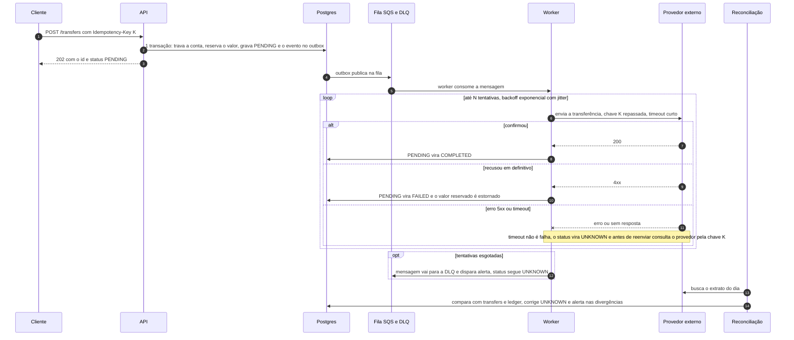

# Banking Transactions API

API REST de contas e movimentações financeiras: criar conta, bloquear/desbloquear/encerrar, depositar, transferir entre contas com idempotência, consultar transferência e extrato paginado. Foco: **saldo nunca negativo, nenhuma movimentação duplicada e tudo rastreável**, com a menor quantidade de código que defenda isso.

Stack: Node 24 + TypeScript, Fastify 5, Zod 4, `pg` (SQL puro, sem ORM), PostgreSQL 17, Vitest + Testcontainers, Biome. Como a IA foi usada: [AI_USAGE.md](AI_USAGE.md).

## 1. Como rodar

Pré-requisito: Docker (Compose v2). Node 24 só é necessário para rodar testes e lint fora do container.

```bash
docker compose up --build   # ou: make up
```

Sobe a API e o PostgreSQL; as migrations rodam na inicialização, sem configuração manual.

| O quê | Onde |
|---|---|
| API | http://localhost:3000 |
| Swagger UI / OpenAPI JSON | http://localhost:3000/docs / http://localhost:3000/docs/json |
| Liveness / readiness | `/health` / `/ready` |

- Porta 3000 ocupada: `API_PORT=3400 docker compose up --build`. `POSTGRES_USER`, `POSTGRES_PASSWORD` e `POSTGRES_DB` também são variáveis do compose (veja `.env.example`).
- `make down` mantém o volume do banco. Para zerar os dados use `docker compose down -v`; isso também é necessário depois de mudar `POSTGRES_PASSWORD`, porque o Postgres só lê a senha na primeira inicialização.
- CI (`.github/workflows/ci.yml`): lint, build, testes, `docker build` e um smoke do compose em `/ready`.

Variáveis da API, todas com padrão exceto `DATABASE_URL` (obrigatória; o compose já a define): `PORT` (3000), `LOG_LEVEL` (info), `DB_POOL_MAX` (10), `DB_LOCK_TIMEOUT_MS` (5000), `DB_STATEMENT_TIMEOUT_MS` (15000), `OUTBOX_RELAY_ENABLED` (true; liga o relay do outbox nesta instância) e `OUTBOX_RELAY_INTERVAL_MS` (1000).

## 2. Testes

```bash
make test   # na primeira vez instala as dependências (npm ci); depois vitest, e o Testcontainers sobe um Postgres 17 descartável sozinho (precisa de Docker)
make lint   # Biome + tsc --noEmit (também instala as dependências se faltarem)
```

Os testes de API chamam a aplicação real (`app.inject`) contra um Postgres de verdade, não mocks: um banco em memória não reproduziria locks, `CHECK`, `ON CONFLICT` nem timeouts, que são justamente o que está em teste. Os testes de corrida da idempotência e do relay são sincronizados (seguram o lock até as requisições enfileirarem, senão quase não se sobrepõem) e foram validados por mutação do código: sem o `ON CONFLICT` ou sem o `SKIP LOCKED` eles falham.

| Arquivo | O que prova |
|---|---|
| `test/unit/money.test.ts` | reais↔centavos sem float: `0.1 + 0.2` e `1e-7` viram 400, `1e15` e qualquer valor acima do teto viram 422, o teto exato passa |
| `test/unit/account-rules.test.ts`, `transfer-rules.test.ts` | transições de status (CLOSED é terminal, não encerra com saldo), normalização de CPF/CNPJ; transferência: origem não ativa, destino encerrado, saldo insuficiente, destino BLOCKED recebe |
| `test/unit/config.test.ts` | padrões, overrides por env e falha rápida sem `DATABASE_URL` |
| `test/api/foundation.test.ts` | `/health` e `/ready`; envelope de erro (400/404/413/415/500/503) sem vazar mensagem interna nem o `detail` do `pg` no log; `correlationId` aceito, gerado e presente no log; pool esgotado vira 503 em vez de pendurar; timeouts em toda conexão; migrations idempotentes; `BIGINT` volta como `number`; `withTransaction` faz commit e rollback |
| `test/api/accounts.test.ts` | criar/consultar/mudar status; documento duplicado com e sem máscara; 5 criações paralelas com o mesmo documento dão 1 × 201 e 4 × 409; UUID inválido, campo extra e JSON malformado são 400, nunca 500; `text/plain` é 415 |
| `test/api/deposits.test.ts` | 10 depósitos de R$ 0,10 somam exatamente R$ 1,00; BLOCKED recebe, CLOSED recusa (422); idempotência do depósito, inclusive com o id da conta em maiúsculas e 5 requisições paralelas com a mesma chave |
| `test/api/transfers.test.ts` | saldo de R$ 100 e transferência de R$ 150: 422, saldo continua R$ 100 e a tentativa fica `FAILED`; origem BLOCKED/CLOSED, destino CLOSED, mesma conta, conta inexistente (404); valor inválido não grava nada nem consome a chave; evento do outbox só nas concluídas |
| `test/api/idempotency.test.ts` | retry com a mesma chave: um débito, mesma resposta, `Idempotent-Replayed: true`; `250` = `250.00` com os campos em outra ordem; payload diferente → 422; replay de `FAILED` continua `FAILED` mesmo depois de depositar; replay depois de bloquear a origem devolve o 201 original; 10 requisições paralelas com a mesma chave: uma movimentação, mesmo `id` |
| `test/api/concurrency.test.ts` | saldo de R$ 100 e duas transferências paralelas de R$ 80: só uma conclui; rajadas paralelas sem saldo negativo; A→B e B→A simultâneos sem deadlock; rajada aleatória entre 5 contas com saldo igual ao ledger; conta quente travada: 503 + `Retry-After`, e o retry com a mesma chave executa depois |
| `test/api/statement.test.ts` | ordem e `balanceAfter`; `FAILED` não aparece; borda do período (`to=2026-09-10` inclui `23:59:59.999Z` e exclui `2026-09-11T00:00:00Z`); data, `limit` e `cursor` inválidos → 400; paginação sem duplicar; ordenação numérica do `id` na virada de dígitos |
| `test/api/openapi.test.ts` | `/docs/json` é OpenAPI 3 com todas as rotas; todo erro é um `$ref` para o único `ErrorEnvelope`; `/docs` serve o HTML do Swagger UI |
| `test/outbox.test.ts` | relay publica uma vez; falha incrementa `attempts` e para em 10; `last_error` truncado e sem NUL; dois relays concorrentes não publicam o mesmo evento (`SKIP LOCKED`); `startRelay` com intervalo e parada limpa |

## 3. Consumindo a API

Swagger UI em `/docs`, gerado dos mesmos schemas Zod que validam as requisições (não diverge do código). Dinheiro trafega como `number` em reais (`"amount": 250.00`) e datas em ISO 8601 UTC. Rotas: `POST /accounts`, `GET /accounts/{id}`, `PATCH /accounts/{id}/status`, `POST /accounts/{id}/deposits`, `POST /transfers`, `GET /transfers/{id}`, `GET /accounts/{id}/statement`, `GET /health`, `GET /ready`.

Roteiro com `curl` (precisa de `jq`; a API tem que estar no ar):

```bash
BASE=http://localhost:3000
JSON='content-type: application/json'

# 1. duas contas; RUN deixa documentos e chaves únicos (a chave é global), então o roteiro pode rodar mais de uma vez
RUN=$RANDOM$RANDOM
DOC_A=$(printf '%011d' "${RUN}1"); DOC_B=$(printf '%011d' "${RUN}2")
A=$(curl -s -X POST $BASE/accounts -H "$JSON" -d "{\"holderName\":\"Ana Souza\",\"document\":\"$DOC_A\"}" | jq -r .id)
B=$(curl -s -X POST $BASE/accounts -H "$JSON" -d "{\"holderName\":\"Bruno Lima\",\"document\":\"$DOC_B\"}" | jq -r .id)

# 2. mesmo documento de novo -> 409 DOCUMENT_ALREADY_EXISTS
curl -s -X POST $BASE/accounts -H "$JSON" -d "{\"holderName\":\"Outra Ana\",\"document\":\"$DOC_A\"}"

# 3. depósito de R$ 500 em A -> 201
curl -s -X POST $BASE/accounts/$A/deposits -H "$JSON" -d '{"amount":500.00}'

# 4. transferência A -> B de R$ 250 com a chave abc123-$RUN -> 201 COMPLETED (guarde o id)
BODY="{\"sourceAccountId\":\"$A\",\"destinationAccountId\":\"$B\",\"amount\":250.00}"
T=$(curl -s -X POST $BASE/transfers -H "$JSON" -H "Idempotency-Key: abc123-$RUN" -d "$BODY" | jq -r .id)

# 5. retry: mesma chave, mesmo payload (250 == 250.00) -> 201 igual + "Idempotent-Replayed: true"; saldo de A continua 250
curl -si -X POST $BASE/transfers -H "$JSON" -H "Idempotency-Key: abc123-$RUN" -d "${BODY/250.00/250}"
curl -s $BASE/accounts/$A

# 6. mesma chave, valor diferente -> 422 IDEMPOTENCY_KEY_REUSED
curl -s -X POST $BASE/transfers -H "$JSON" -H "Idempotency-Key: abc123-$RUN" -d "${BODY/250.00/100.00}"

# 7. saldo insuficiente -> 422 INSUFFICIENT_BALANCE com transferId; a tentativa fica registrada como FAILED
curl -s -X POST $BASE/transfers -H "$JSON" -H "Idempotency-Key: def456-$RUN" -d "${BODY/250.00/1000.00}"

# 8. consultar a transferência do passo 4
curl -s $BASE/transfers/$T

# 9. extrato de hoje (UTC), 1 item por página: a segunda chamada usa o nextCursor da primeira
TODAY=$(date -u +%F)
PAGE=$(curl -s "$BASE/accounts/$A/statement?from=$TODAY&to=$TODAY&limit=1"); echo "$PAGE"
curl -s "$BASE/accounts/$A/statement?from=$TODAY&to=$TODAY&limit=1&cursor=$(echo "$PAGE" | jq -r .nextCursor)"

# 10. bloquear A: não debita (422 SOURCE_ACCOUNT_NOT_ACTIVE), mas ainda recebe crédito (201)
curl -s -X PATCH $BASE/accounts/$A/status -H "$JSON" -d '{"status":"BLOCKED"}'
curl -s -X POST $BASE/transfers -H "$JSON" -H "Idempotency-Key: ghi789-$RUN" -d "${BODY/250.00/10.00}"
curl -s -X POST $BASE/accounts/$A/deposits -H "$JSON" -d '{"amount":10.00}'

# 11. entradas inválidas nunca viram 500
curl -s -X POST $BASE/transfers -H "$JSON" -H "Idempotency-Key: jkl012-$RUN" -d "${BODY/250.00/0.30000000000000004}"   # 400 (mais de 2 casas)
curl -s $BASE/accounts/nao-e-uuid                                                                                      # 400
curl -s -X POST $BASE/transfers -H "$JSON" -d "$BODY"                                                                  # 400 (sem Idempotency-Key)

# 12. rastrear: pelo correlation id (a requisição inteira) e pelo transferId (a linha da transferência)
curl -s -H 'x-correlation-id: demo-123' $BASE/accounts/$A
docker compose logs api | grep demo-123
docker compose logs api | grep "$T"
```

## 4. Decisões

### Estrutura: por feature, sem Clean/Hexagonal completo

Uma pasta por feature em `src/<feature>/`, `routes.ts` (HTTP e schema Zod de entrada, saída e OpenAPI), `service.ts` (SQL e transação) e `rules.ts` onde há regra pura (accounts, transfers: regra de negócio sem I/O, testável sem banco). Código compartilhado em `src/shared/` (erros, dinheiro, schemas), mais `src/db.ts` (pool, `withTransaction`, migrations), `src/config.ts` e `src/app.ts`.

Por que não Clean/Hexagonal: o domínio cabe em 5 tabelas e a correção da transferência *depende* do SQL (lock, ordem, `CHECK`, `ON CONFLICT`). Portas e repositórios aqui só repassariam chamadas e esconderiam o trecho que a revisão precisa enxergar. A regra que muda com o negócio (saldo, status) fica isolada em `rules.ts`. Trade-off aceito: trocar de banco significa reescrever os `service.ts`; como a consistência vem de recursos do Postgres, a troca não seria mecânica de qualquer jeito.

Dependências de runtime: `fastify`; `zod` + `fastify-type-provider-zod` (um schema só valida, tipa e gera o OpenAPI) com `@fastify/swagger` e `@fastify/swagger-ui` (o `/docs`); `pg`. Sem ORM, pelo mesmo motivo acima.

### Transações e concorrência

- **Uma transação por comando.** Toda escrita roda em `withTransaction` (BEGIN/COMMIT, ROLLBACK em qualquer erro): a transferência inteira vale ou nada vale. `GET` roda sem transação. Isolamento padrão (READ COMMITTED): os locks de linha já serializam o que importa.
- **Lock pessimista, ordem fixa.** As contas envolvidas são lidas com `SELECT ... ORDER BY id FOR UPDATE`. A→B e B→A pedem os locks **na mesma ordem**, então não há deadlock. Com o lock, o saldo lido é o real: duas transferências de R$ 80 com R$ 100 na conta executam em fila, e a segunda vê R$ 20 e é rejeitada.
- **`CHECK (balance_cents >= 0)`** é a última defesa: se um bug futuro debitar a mais, o Postgres aborta a transação; saldo negativo nunca é gravado.
- **`lock_timeout` de 5 s:** conta quente travada por outra transação falha rápido com 503 + `Retry-After` em vez de pendurar a requisição.

Por que não **otimista** (coluna `version`): em conta quente o conflito é o caso comum, não a exceção; cada colisão viraria erro + loop de retry na aplicação, mais código para o mesmo resultado. Por que não **SERIALIZABLE**: o Postgres aborta com `40001` sob conflito e a transação inteira precisa ser reexecutada, com falsos positivos por causa dos predicate locks; seria pagar retry e throughput para proteger o que `FOR UPDATE` já protege com uma cláusula. Custo do que escolhi: transferências da mesma conta são serializadas (seção 6).

### Idempotência

**Fluxo de `POST /transfers`** (uma transação; é a ordem real do código):

1. Busca a chave. Se existe e o payload é equivalente, é replay; se o payload é diferente, 422 `IDEMPOTENCY_KEY_REUSED`.
2. Trava as duas contas (`ORDER BY id FOR UPDATE`); falta alguma: 404.
3. Aplica as regras e insere em `transfers` com `ON CONFLICT (idempotency_key) DO NOTHING`, já como `COMPLETED` ou `FAILED`.
4. Se o insert não devolveu linha, outra requisição com a mesma chave commitou antes: relê a chave e responde como no passo 1 (replay ou 422), nunca 500.
5. Só se `COMPLETED`: atualiza os dois saldos e grava os dois lançamentos do ledger e o evento do outbox.

Duas requisições simultâneas com a mesma chave caem no passo 4. Com as **mesmas contas**, a segunda espera o lock do passo 2 e devolve o resultado da primeira (coberto por teste: 10 em paralelo, uma movimentação). Com **contas diferentes** não há disputa de lock: o `INSERT` da segunda espera a primeira terminar (índice `UNIQUE`) e então responde 422 `IDEMPOTENCY_KEY_REUSED`. Nunca 500 e nunca duas movimentações; o caso de contas diferentes decorre do `UNIQUE` e não tem teste dedicado.

Regras:

- **Chave:** `Idempotency-Key`, 1–255 caracteres ASCII visíveis. Não exige UUID (o enunciado usa `abc123`). Obrigatória em `POST /transfers`; opcional em depósito (sem chave, cada POST é um depósito novo; com chave, a mesma ordem de passos vale, sem o `FAILED`). `UNIQUE` no banco (`transfers`, `deposits`), escopo global; em produção seria por cliente autenticado.
- **Equivalência por campos normalizados**, não pelo corpo cru: origem, destino e valor em centavos (no depósito, conta e centavos). `250` e `250.00`, ou campos em outra ordem, são o mesmo payload; comparar o corpo cru faria um retry legítimo parecer "payload diferente".
- **Replay** devolve o mesmo status do original (201 ou 422), o mesmo corpo e `Idempotent-Replayed: true`. Nunca reexecuta, mesmo que o mundo tenha mudado (conta bloqueada depois, saldo depositado depois).
- **Mesma chave, payload diferente → 422 `IDEMPOTENCY_KEY_REUSED`**, como no draft IETF `httpapi-idempotency-key-header`. Rejeitar é mais seguro que escolher qual das duas intenções vale; o cliente com um bug de reuso de chave descobre na hora.
- **Rejeição de negócio depois de travar as contas** (saldo insuficiente, origem não ativa, destino encerrado) é **persistida** como transferência `FAILED` e **consome a chave**: o retry devolve a mesma 422 com o mesmo `transferId`. Motivo: o retry precisa ser determinístico e auditável; sem gravar, o mesmo request daria 422 hoje e 201 amanhã. Quem quer tentar de novo usa **outra chave**. Custo assumido: o cliente que recebeu `INSUFFICIENT_BALANCE`, depositou e reenviou com a mesma chave continua recebendo a 422 original.
- **Não gravam nada nem consomem a chave:** 400, 404, `SAME_ACCOUNT`, `INVALID_AMOUNT`, `AMOUNT_LIMIT_EXCEEDED` e 503 (salvo conexão que caiu depois do `COMMIT`, ver seção 5). O depósito não tem estado `FAILED`: a rejeição (`ACCOUNT_CLOSED`) também não grava nada.
- **Sem expiração** neste escopo (TTL e limpeza: seção 8).

### Dinheiro em centavos

Saldo e valores são inteiros de centavos: `BIGINT` no banco, `number` seguro (`Number.isSafeInteger`) no TypeScript, nunca aritmética de float em reais. A conversão existe em um lugar só, `src/shared/money.ts`, e lê a representação decimal mais curta do número em vez de multiplicar o float por 100; assim `0.1 + 0.2` (`0.30000000000000004`) é rejeitado com 400 em vez de arredondado. O parser de `BIGINT` do `pg` lança se um valor passar de 2^53. Teto por operação: R$ 1.000.000.000,00.

O JSON usa `number` em reais, como no enunciado. Trade-off: um cliente que some floats do lado dele ainda pode se confundir; a API só aceita e devolve valores com até 2 casas.

### Status 400 vs 422

Regra de bolso: erro na **forma** do pedido (schema, JSON malformado, UUID inválido, mais de 2 casas, campo extra, `Idempotency-Key` ausente ou inválida, data ou `cursor` inválidos) → **400 `VALIDATION_ERROR`**; item listado como **regra** de negócio no enunciado → **422** com o código da regra (`INSUFFICIENT_BALANCE`, `SOURCE_ACCOUNT_NOT_ACTIVE`, `ACCOUNT_CLOSED`, ...). O resto: 404 (`*_NOT_FOUND`), 409 (`DOCUMENT_ALREADY_EXISTS`, inclusive em corrida), 413, 415, 500 e 503. A lista completa de códigos está no `/docs`.

Valor gigante (`1e15`) é 422 `AMOUNT_LIMIT_EXCEEDED`: o pedido está bem formado, só passa do teto. Todo erro tem o mesmo envelope: `{ code, message, timestamp, correlationId }`, mais `details` no 400 de schema e `transferId` na 422 de transferência persistida. Nunca stack trace, SQL ou mensagem do Postgres.

Regras de conta: `BLOCKED` recebe crédito mas não debita; `CLOSED` não movimenta e é terminal; só se encerra conta com saldo zero. Não há endpoint separado de encerramento: é `PATCH .../status` com `CLOSED`. O documento aceita CPF (11 dígitos) ou CNPJ (14), com ou sem máscara, é guardado só com dígitos e não tem os dígitos verificadores validados (o enunciado dispensa).

### Extrato

Cada mudança de saldo é uma linha em `ledger_entries` com o `balance_after_cents` daquele momento. O extrato é ordenado por `ledger_entries.id` crescente (mais antigo primeiro), **não** por `created_at`: as linhas de uma conta só são inseridas com a conta travada, então a ordem do `id` é a ordem real em que o saldo mudou e bate com `balanceAfter`. `created_at` serve para filtrar o período.

- **Cursor** é o `id` da última linha, não um timestamp: o `timestamptz` do Postgres tem microssegundos e o `Date` do JS só milissegundos, e um cursor por `created_at` repetiria ou pularia linhas na virada da página.
- **Período** em UTC, `to` inclusivo até `23:59:59.999Z`. Os limites são calculados no TypeScript como instantes UTC; `created_at >= $1::date` no SQL usaria o `TimeZone` da sessão e deslocaria o dia.

### Eventos: outbox

Uma transferência concluída grava, **na mesma transação**, um evento `TransferCompleted` em `outbox_events`: não existe transferência sem evento nem evento de transferência que não aconteceu (o "salvou no banco e caiu antes de publicar"). Um relay dentro do processo da API lê os pendentes a cada `OUTBOX_RELAY_INTERVAL_MS` e os entrega a um publicador, que neste escopo só escreve `event published` no log; marca `published_at` ao publicar e, em falha, incrementa `attempts` e guarda `last_error`. Depois de 10 tentativas o evento para de ser tentado e fica à espera de alguém (como achar: seção 5). O relay repete em intervalo fixo, sem backoff; com um broker de verdade eu usaria um `next_attempt_at` com backoff exponencial ou o retry e a DLQ nativos do SQS. Entrega **at least once**: o consumidor deduplica pelo `eventId`. O publicador real (SNS/SQS, Kafka) fica fora do escopo (seção 8).

## 5. Operação

**Logs.** JSON em stdout (pino). Cada linha de requisição tem `correlationId` (as do relay e da inicialização não): o header `x-correlation-id` é aceito se casar `^[A-Za-z0-9._-]{1,128}$`, senão a API gera um UUID; o valor volta no header da resposta e no envelope de erro. A linha da transferência (`transfer processed`) traz também `transferId` e `idempotencyKey`. **Nunca** vão para o log o documento nem o corpo da requisição; o `detail` dos erros do `pg` (que pode conter o documento de uma violação de unicidade) é descartado.

**Como rastrear uma transferência.**

1. O cliente tem o `correlationId` (header da resposta) ou o `transferId` (corpo, inclusive o da 422 persistida).
2. `docker compose logs api | grep <correlationId>` mostra a requisição inteira. `grep <transferId>` acha a linha `transfer processed`, que liga `transferId`, `idempotencyKey` e `correlationId`, e o `correlationId` leva à requisição.
3. No banco, o rastro completo está em `transfers` (pela chave: `WHERE idempotency_key = '<chave>'`), nos dois lançamentos de `ledger_entries` (`WHERE transfer_id = ...`) e no evento do outbox (`WHERE aggregate_id = ...`). Acesso: `docker compose exec db psql -U banking`.

**`/health` vs `/ready`.** `/health` é liveness: responde 200 sem tocar o banco (o orquestrador só reinicia o processo se ele travar). `/ready` é readiness: executa `SELECT 1` e devolve 503 se o banco não responde (o balanceador tira a instância da rotação sem reiniciá-la).

**Timeouts e 503.** Nada espera para sempre:

| Onde | Limite | Resultado |
|---|---|---|
| esperar uma conexão livre do pool | 5 s | 503 |
| `lock_timeout` (conta quente travada) | 5 s (`DB_LOCK_TIMEOUT_MS`) | 503 |
| `statement_timeout` | 15 s (`DB_STATEMENT_TIMEOUT_MS`) | 503 |
| `idle_in_transaction_session_timeout` | 30 s | o Postgres derruba a transação esquecida |

Também viram 503 com `Retry-After: 1`: deadlock (`40P01`), falha de serialização (`40001`) e conexão recusada, reiniciada ou pool encerrado. O 503 em geral não grava nada e não consome a chave, mas pode ter gravado se a conexão caiu depois do `COMMIT`; repetir com a **mesma** chave é seguro (se gravou, vira replay).

**Shutdown gracioso.** Em `SIGTERM`/`SIGINT` a API para o relay do outbox (esperando a rodada em andamento), para de aceitar conexões novas, espera as requisições em andamento e fecha o pool antes de sair, para não cortar uma transação no meio.

**Eventos parados** (estouraram 10 tentativas):

```sql
SELECT id, event_type, aggregate_id, attempts, last_error, created_at
FROM outbox_events
WHERE published_at IS NULL AND attempts >= 10
ORDER BY created_at;
```

Corrigida a causa (veja `last_error`), `UPDATE outbox_events SET attempts = 0 WHERE id = '...'` devolve o evento ao relay.

## 6. Escala: 10x e 100x

Onde quebra primeiro: a **conta quente**. O lock de linha serializa todas as transferências que tocam a mesma conta, então o teto por conta é aproximadamente `1 / duração da transação`; passando disso, as requisições esperam até o `lock_timeout` e viram 503.

**10x (ajuste e infraestrutura, o modelo continua o mesmo)**

- **Pool e PgBouncer.** Hoje são até 10 conexões por instância; com várias instâncias o `max_connections` do Postgres acaba rápido. PgBouncer em modo transaction na frente do banco; os timeouts de sessão passam a `SET LOCAL` dentro da transação.
- **Réplica de leitura** para extrato e consulta de conta. Cuidado com o lag: `GET /transfers/{id}` logo depois do `POST` continua indo ao primário.
- **Relay do outbox fora do processo da API**, como worker próprio e escalável à parte (`OUTBOX_RELAY_ENABLED=false` nas APIs). Com vários workers o `FOR UPDATE SKIP LOCKED` já evita que disputem as mesmas linhas.

**100x (muda o desenho)**

- **Conta quente**, em ordem de preferência: (1) *fila por conta*: as transferências de uma conta entram numa fila particionada pelo id da conta e um consumidor aplica uma por vez, sem briga de lock no banco, e a API passa a responder 202; (2) *particionar por conta*: shard do banco pelo id da conta (transferência entre shards vira saga, com muito mais complexidade); (3) *saldo em sub-contas*: a conta quente vira N "baldes" e cada débito escolhe um com saldo suficiente, ao custo de juntar baldes quando o valor é maior que qualquer um.
- **Particionar `ledger_entries` por mês** (por `created_at`), arquivando as partições antigas: o extrato sempre filtra por conta e período, então poda partição. Exige rever a chave primária e o cursor, que hoje é o `id`.

## 7. Provedor externo (desafio adicional, só documento)

Nada disto está implementado: é como eu desenharia uma transferência que depende de um provedor financeiro externo que pode demorar, errar ou sair do ar.



- **Processamento assíncrono e reserva.** A transferência externa nasce `PENDING` com o dinheiro reservado, na mesma transação do evento do outbox (mesmo padrão da seção 4): nenhuma outra transferência gasta o mesmo saldo, e o cliente já tem um `id` para consultar em `GET /transfers/{id}`. Um worker consome a fila (outbox → SQS). Modelagem: o `CHECK` de `status` passa a aceitar `PENDING` e `UNKNOWN`; a reserva é o débito imediato do saldo com um lançamento no ledger (o estorno vira um lançamento novo), ou uma tabela `holds` se o saldo disponível precisar ficar separado do contábil.
- **Timeout.** Chamada ao provedor com timeout curto. Timeout não é falha: sem resposta, o provedor pode ter processado, e tratar como `FAILED` com estorno arriscaria pagar duas vezes. O status fica `UNKNOWN`, o dinheiro continua reservado, e só uma consulta ao provedor (ou a reconciliação) resolve para `COMPLETED` ou `FAILED`.
- **Retry.** Só em erro retentável (timeout, 5xx, 429), com backoff exponencial e jitter, para as retentativas de muitas transferências não baterem juntas no provedor que acabou de voltar. Recusa definitiva (4xx de negócio) não se repete: vira `FAILED` e o estorno. Esgotadas as tentativas, a mensagem vai para a DLQ com alerta e o status segue `UNKNOWN` até alguém ou a reconciliação resolver.
- **Requisição duplicada.** Do cliente, a nossa idempotência já absorve. Do nosso lado, o worker repassa a `Idempotency-Key` da transferência ao provedor, então um reenvio (retry do worker, mensagem entregue duas vezes) devolve o resultado original em vez de transferir de novo. Se o provedor não suportar chave, consultamos o estado por referência antes de reenviar.
- **Circuit breaker.** Depois de N falhas seguidas em uma janela, o breaker abre e paramos de chamar o provedor; passado um tempo ele fica half-open e deixa passar poucas chamadas de teste. Com o breaker aberto a API pode responder 503 + `Retry-After` (nada reservado) ou aceitar a transferência como `PENDING` e deixar o worker drenar quando fechar. Eu começaria por `PENDING` (dinheiro já reservado, cliente com id) e deixaria o 503 para quando a fila passar de um limite.
- **Reconciliação diária.** Um job compara o extrato do provedor com o nosso `transfers` e `ledger_entries` pela referência (a nossa chave): `UNKNOWN` que o provedor confirmou vira `COMPLETED`; `UNKNOWN` que ele desconhece vira `FAILED` com estorno; o que existe de um lado só gera alerta para investigação. Toda correção é um lançamento novo no ledger com origem registrada, nunca um `UPDATE` de saldo.

## 8. Fora do escopo e pendências

O enunciado pede uma API pequena e correta, e saber o que não construir faz parte. O que ficou de fora, com como eu faria e o risco de não ter:

| Item | Como faria | Risco hoje |
|---|---|---|
| Autenticação e rate limiting | JWT ou mTLS no gateway; rate limit por conta e por IP | qualquer um que alcance a API movimenta dinheiro |
| Idempotência: escopo global e chaves sem expiração | escopo `(cliente, chave)` depois da autenticação; TTL (de 24 h a 7 dias, a decidir com os clientes) e job de limpeza, que também apaga `outbox_events` já publicados | um cliente que reaproveite a chave de outro recebe o replay alheio; as tabelas e o índice `UNIQUE` crescem sem fim |
| Broker real (SNS/SQS ou Kafka) | publicador de verdade no relay, consumidor idempotente | os eventos não saem do processo (só aparecem no log) |
| CPF/CNPJ sem dígito verificador | validar o checksum em `rules.ts` | documento inválido entra na base |
| Documento em claro no banco e na resposta | criptografar em repouso e mascarar na resposta | exposição de dado pessoal se o banco vazar |
| Métricas e tracing | Prometheus (latência, 503, fila do outbox) e OpenTelemetry | só dá para investigar por log |
| Teste de carga | k6 contra uma conta quente, medindo o teto da seção 6 | o limite de throughput é estimado, não medido |
| Saldo acima de 2^53 centavos | trafegar `BIGINT` como `bigint`/string de ponta a ponta | ~90 mil depósitos do teto (R$ 1 bi) passam disso; o parser do `pg` lança dentro da transação, a operação dá rollback e responde 500 (falha fechada, sem saldo errado) |
| Redis, multimoeda, listagem de contas e de transferências, endpoint de encerramento (é um `PATCH` de status), provedor externo (só seção 7) | não construídos de propósito | nenhum para o enunciado |
