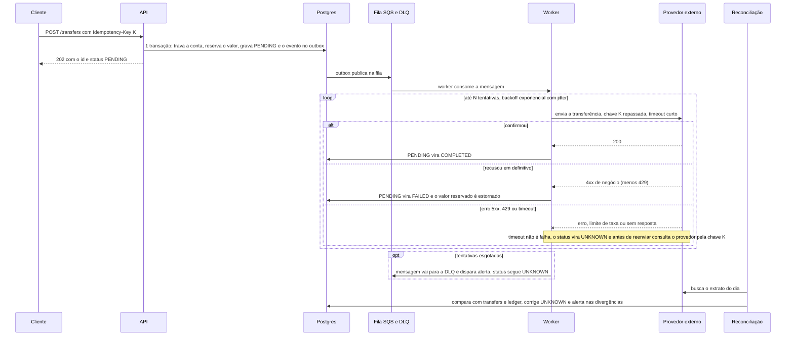

# Escala e provedor externo

Detalhe das seções 6 e 7 do [README](../README.md).

## Escala: 10x e 100x

Onde quebra primeiro: a **conta quente**. O lock de linha serializa todas as transferências que tocam a mesma conta, então o teto por conta é aproximadamente `1 / duração da transação`; passando disso, as requisições esperam e viram 503: na prática pelo timeout do pool, porque cada uma que espera o lock segura uma conexão, e pelo `lock_timeout` quando ainda sobra conexão (ver abaixo).

**Ordem de grandeza**, medida uma vez durante o desenvolvimento, antes da rodada final de correções, num host compartilhado, por agentes de IA da revisão com carga sintética (k6) direto na API; não há script versionado, então vale como ordem de grandeza, não como garantia: na casa de mil transferências/s com muitas contas e algumas centenas por segundo numa única conta quente, onde o lock fica preso por cerca de 6 idas ao banco mais o `COMMIT`.

- **O estrago passa da conta quente.** Cada requisição esperando o lock segura uma conexão do pool; com as 10 ocupadas, as requisições de outras contas e o `/ready` esperam conexão e estouram os 5 s. Os 503 da conta quente vieram do timeout do pool, não do `lock_timeout`, e um `/ready` que falha tira a instância da rotação. Mitigações baratas:
  - um `lock_timeout` curto, abaixo do timeout do pool, para a conta quente falhar rápido sem segurar o pool (a primeira que eu adotaria em produção);
  - limitar a concorrência por conta antes de pegar conexão;
  - menos idas ao banco com o lock preso (um CTE ou função no lugar das ~6; é onde o `UPDATE` condicional do [README, seção 4](../README.md#transações-e-concorrência) ajudaria).

  A definitiva é a fila por conta, abaixo.
- **Extrato de uma conta enorme** (medido à parte, num Postgres descartável com centenas de milhares de linhas no ledger, a maioria de uma conta só): a primeira página fica ordens de grandeza mais lenta que nas contas pequenas, porque o planner percorre a PK e descarta pelo filtro de conta as linhas das outras contas. `ORDER BY account_id, id` dá o mesmo plano (o `EXPLAIN ANALYZE` mostra isso; quem mediu foi uma instância de IA, e li o resultado) e a comparação de linha `(account_id, id) > (...)` conserta a primeira página, mas deixa cada página proporcional à profundidade. A correção de verdade é uma sequência por conta ou o particionamento abaixo.

**10x (ajuste e infraestrutura, o modelo continua o mesmo)**

- **Pool e PgBouncer.** Hoje são até 10 conexões por instância; com várias instâncias o `max_connections` do Postgres acaba rápido. PgBouncer em modo transaction na frente do banco; os timeouts de sessão passam a `SET LOCAL` dentro da transação.
- **Réplica de leitura** para extrato e consulta de conta. Cuidado com o lag: `GET /transfers/{id}` logo depois do `POST` continua indo ao primário.
- **Relay do outbox fora do processo da API**, como worker próprio e escalável à parte (`OUTBOX_RELAY_ENABLED=false` nas APIs). Com vários workers o `FOR UPDATE SKIP LOCKED` já evita que disputem as mesmas linhas. O relay drena um backlog lote após lote, sem teto fixo de eventos por segundo; a vazão é a de um `UPDATE` por evento (não medida isoladamente).

**100x (muda o desenho)**

- **Conta quente**, em ordem de preferência: (1) *fila por conta*: as transferências de uma conta entram numa fila particionada pelo id da conta e um consumidor aplica uma por vez, sem briga de lock no banco, e a API passa a responder 202; (2) *particionar por conta*: shard do banco pelo id da conta (transferência entre shards vira saga, com muito mais complexidade); (3) *saldo em sub-contas*: a conta quente vira N "baldes" e cada débito escolhe um com saldo suficiente, ao custo de juntar baldes quando o valor é maior que qualquer um.
- **Particionar `ledger_entries` por mês** (por `created_at`), arquivando as partições antigas. Só ajuda o extrato que traz `from`/`to`: eles são opcionais, e sem período a consulta varre todas as partições da conta, então eu passaria a exigir ou a assumir um período padrão (por exemplo, os últimos 90 dias). Exige rever a chave primária (a chave de partição entra nela) e o cursor, que hoje é o `id`.

## Provedor externo (desafio adicional)

Nada disto está implementado: é como eu desenharia uma transferência que depende de um provedor financeiro externo que pode demorar, errar ou sair do ar.

- **Processamento assíncrono e reserva.** A transferência externa nasce `PENDING` com o dinheiro reservado, na mesma transação do evento do outbox (mesmo padrão do [README, seção 4](../README.md#eventos-outbox)): nenhuma outra transferência gasta o mesmo saldo, e o cliente já tem um `id` para consultar em `GET /transfers/{id}`. Um worker consome a fila (outbox → SQS). Modelagem: o `CHECK` de `status` passa a aceitar `PENDING` e `UNKNOWN`; a reserva é o débito imediato do saldo com um lançamento no ledger (o estorno vira um lançamento novo), ou uma tabela `holds` se o saldo disponível precisar ficar separado do contábil.
- **Timeout.** Chamada ao provedor com timeout curto. Timeout não é falha: sem resposta, o provedor pode ter processado, e tratar como `FAILED` com estorno arriscaria pagar duas vezes. O status fica `UNKNOWN`, o dinheiro continua reservado, e só uma consulta ao provedor (ou a reconciliação) resolve para `COMPLETED` ou `FAILED`.
- **Retry.** Só em erro retentável (timeout, 5xx, 429), com backoff exponencial e jitter, para as retentativas de muitas transferências não baterem juntas no provedor que acabou de voltar. Recusa definitiva (4xx de negócio, não o 429) não se repete: vira `FAILED` e o estorno. Esgotadas as tentativas, a mensagem vai para a DLQ com alerta e o status segue `UNKNOWN` até alguém ou a reconciliação resolver.
- **Requisição duplicada.** Do cliente, a nossa idempotência já absorve. Do nosso lado, o worker repassa a `Idempotency-Key` da transferência ao provedor, então um reenvio (retry do worker, mensagem entregue duas vezes) devolve o resultado original em vez de transferir de novo. Se o provedor não suportar chave, consultamos o estado por referência antes de reenviar.
- **Circuit breaker.** Depois de N falhas seguidas em uma janela, o breaker abre e paramos de chamar o provedor; passado um tempo ele fica half-open e deixa passar poucas chamadas de teste. Com o breaker aberto a API pode responder 503 + `Retry-After` (nada reservado) ou aceitar a transferência como `PENDING` e deixar o worker drenar quando fechar. Eu começaria por `PENDING` (dinheiro já reservado, cliente com id) e deixaria o 503 para quando a fila passar de um limite.
- **Reconciliação diária.** Um job compara o extrato do provedor com o nosso `transfers` e `ledger_entries` pela referência (a nossa chave): `UNKNOWN` que o provedor confirmou vira `COMPLETED`; `UNKNOWN` que ele desconhece vira `FAILED` com estorno; o que existe de um lado só gera alerta para investigação. Toda correção é um lançamento novo no ledger com origem registrada, nunca um `UPDATE` de saldo.
