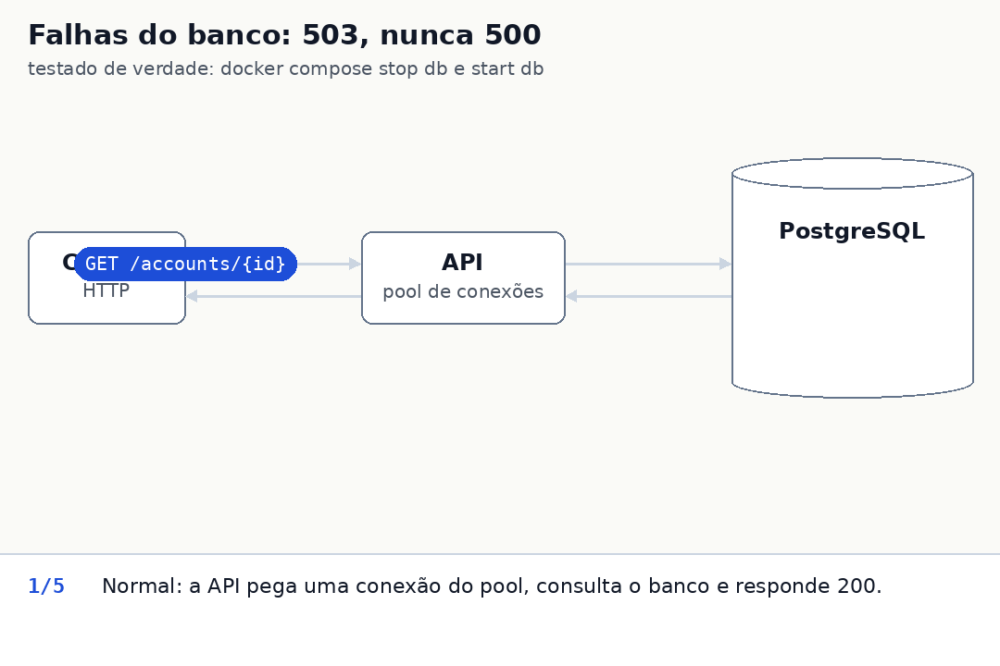
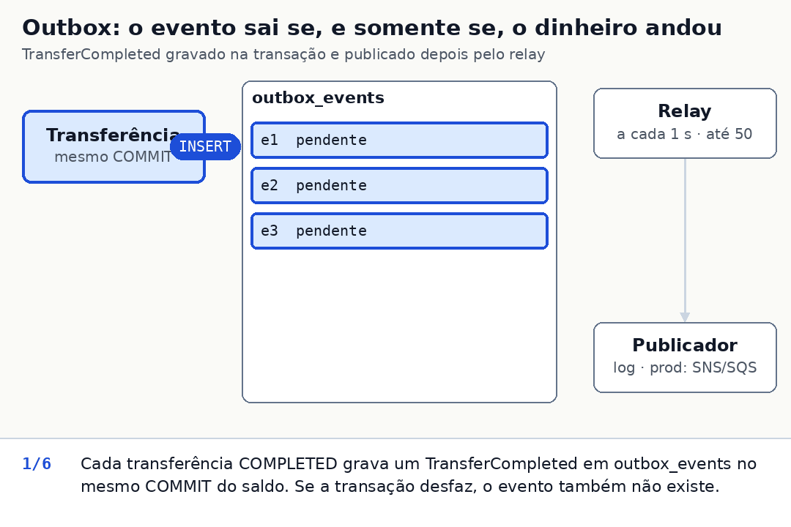

# Operação

Detalhe da seção 5 do [README](../README.md#5-operação): logs, rastreio, health, timeouts, falhas do banco, shutdown e o relay do outbox.

## Logs

JSON em stdout (pino).

- **Correlation id.** Toda linha de requisição tem `correlationId` (as do relay e da inicialização não). O header `x-correlation-id` é aceito se casar `^[A-Za-z0-9._-]{1,128}$`; senão a API gera um UUID. O valor volta no header da resposta e no envelope de erro.
- **Linhas de negócio**, em info:
  - `account created` (`accountId`);
  - `account status changed` (`accountId`, `from`, `to`, só quando o status mudou);
  - `deposit processed` (`depositId`, `accountId`, `idempotencyKey`, `replayed`);
  - `transfer processed` (`transferId`, `idempotencyKey`, `status`, `failureCode`, `replayed`);
  - `event published` (relay: `eventId`, `eventType`, `transferId` e `correlationId` na raiz, mais o evento inteiro em `event`).
- **Rejeições.** Toda resposta 4xx gera `request rejected` com `code`, `statusCode` e `idempotencyKey`; o 5xx gera `request failed`, também com a chave. A chave só entra se for válida (1 a 255 ASCII visíveis); senão o log leva `idempotencyKeyInvalid: true`, nunca o header cru. Uma 422 se explica só pelos logs.
- **Probes.** `/health` e `/ready` não geram linha de requisição (o healthcheck bate a cada poucos segundos); só a falha aparece (`readiness check failed`).
- **Nunca** vão para o log o documento, o nome nem o corpo da requisição. O `detail` dos erros do `pg` (que pode conter o documento de uma violação de unicidade) é descartado.

## Como rastrear uma transferência

O cliente tem o `correlationId` (header da resposta e envelope de erro) ou o `transferId` (corpo, inclusive o da 422 persistida).

- `docker compose logs api | grep <correlationId>` mostra a requisição inteira, incluindo `transfer processed` e, depois, o `event published` (a linha traz o mesmo `correlationId` na raiz).
- `grep <transferId>` acha o `transfer processed` e o `event published` pelo outro lado, mais as linhas de qualquer replay ou `GET /transfers/<id>`, que trazem o id.
- Caminho: `correlationId` → linhas da requisição → `transferId` → `event published`.
- No banco (`docker compose exec db psql -U banking`): `transfers` (`WHERE idempotency_key = '<chave>'`), os dois lançamentos de `ledger_entries` (`WHERE transfer_id = ...`) e o evento do outbox (`WHERE aggregate_id = ...`).

## `/health` vs `/ready`

- `/health` é liveness: responde 200 sem tocar o banco (o orquestrador só reinicia o processo se ele travar).
- `/ready` é readiness: executa `SELECT 1` e devolve 503 se o banco não responde (o balanceador tira a instância da rotação sem reiniciá-la).

## Timeouts e 503

Nada espera para sempre:

| Onde | Limite | Resultado |
|---|---|---|
| esperar uma conexão livre do pool ou abrir uma nova | 5 s (fixo) | 503 |
| `lock_timeout` (conta quente travada) | 5 s (`DB_LOCK_TIMEOUT_MS`) | 503 |
| `statement_timeout` | 15 s (`DB_STATEMENT_TIMEOUT_MS`) | 503 |
| `query_timeout` do cliente (o banco não responde: congelado, sem reset de TCP) | `statement_timeout` + 5 s = 20 s (derivado, sem variável própria) | 503, a conexão é descartada |
| `ROLLBACK` depois de uma falha | 1 s (fixo) | se estourar, a conexão é destruída e nunca volta ao pool |
| `idle_in_transaction_session_timeout` | 30 s (`DB_IDLE_IN_TX_TIMEOUT_MS`) | o Postgres derruba a transação esquecida |
| requisição (cabeçalhos ou corpo) que não termina de chegar | `headersTimeout` e `requestTimeout` 30 s (fixos; o Node confere a cada 30 s, então o corte vem entre 30 e 60 s) | o Node responde 408, fora do envelope, e fecha a conexão |

- O TCP keepalive começa depois de 10 s de silêncio.
- **Banco congelado** (`docker compose pause db`), medido numa conexão já aberta: 503 em 20 s numa leitura e em 21 s numa transferência (20 s do `query_timeout` + 1 s do `ROLLBACK`), sem reiniciar a API; ao voltar, ela responde sozinha.
- **Pool frio:** o `pg` fecha as conexões ociosas depois de 10 s, e abrir uma conexão nova num banco congelado estoura os 5 s do pool: 503 em 5 s.
- **Viram 503 com `Retry-After: 1`:** os timeouts acima; deadlock (`40P01`); falha de serialização (`40001`); banco indisponível (`57P01`, `57P02`, `57P03`, `53300` e a classe `08`); falhas de rede (`ECONNREFUSED`, `ECONNRESET`, `ENOTFOUND` quando o compose remove o DNS do banco parado, `EAI_AGAIN`, `ETIMEDOUT`, `EHOSTUNREACH`, `ENETUNREACH`, `EPIPE`); pool encerrado; cliente com a conexão já morta.

## Queda de conexão e shutdown

- **Conexão que cai no meio de uma transação** não derruba o processo: todo client em uso tem um listener de `error` (sem ele, um client morto em uso encerra o processo). A requisição afetada recebe 503, o pool descarta o client e a próxima funciona.
- **Restart.** No compose, a API e o banco têm `restart: unless-stopped`: a API volta sozinha se o processo cair ou sair no boot porque o banco não estava pronto (nesse caso ela loga uma linha estruturada e sai com código 1, e a política tenta de novo).
- **Banco parado.** Verificado durante o desenvolvimento por agentes de IA (quem implementou e os revisores), com `docker compose stop db` e `start db` sob carga, e li os resultados: tudo devolve 503 enquanto o banco está fora (`/health` segue 200) e a API volta a responder sozinha, em segundos, quando ele aceita conexões de novo.
- **`SIGTERM`/`SIGINT`.** A API para o relay (esperando a rodada em andamento), para de aceitar conexões, espera as requisições em andamento, fecha cada conexão keep-alive assim que ela fica ociosa e fecha o pool, para não cortar uma transação no meio. O desligamento escreve `shutdown started` (com o sinal) e, ao fechar o pool, `shutdown complete`.
- **Por que fechar as ociosas.** Sem isso, o socket de uma requisição que termina durante o desligamento ficaria aberto pelos 72 s do keep-alive e seguraria o processo. Com isso, um `docker compose stop` sob carga (40 clientes keep-alive) sai com código 0 em menos de 1 s (medido por um agente de IA durante o desenvolvimento; `test/server.test.ts` cobre o caso de uma requisição em andamento).
- **Limite.** O compose define `stop_grace_period: 25s`, acima do `statement_timeout` de 15 s (o padrão de 10 s mandaria `SIGKILL` no meio de uma transação legítima). Um prazo duro de 20 s (log e saída com código 1) só entra em ação quando uma requisição ou o `pool.end()` ficam presos num banco congelado; o que passar disso é cortado e o Postgres dá rollback da transação aberta.



## 503 e resultado incerto

Um 503 quase sempre significa que nada foi gravado (a transação deu rollback e a chave não foi consumida), mas não sempre: se a conexão cai ou o `COMMIT` estoura o timeout, a API não sabe se o banco confirmou.

- Reenvie com a **mesma** `Idempotency-Key`: se gravou, a resposta é um replay; se não, executa. Transferência exige chave, então está coberta.
- **Um depósito enviado sem chave e reenviado depois de um 503 pode creditar duas vezes**; é por isso que recomendo a chave em todo depósito.
- Criar conta se resolve pelo `UNIQUE` (o retry de uma conta que foi criada devolve 409), mas sem listagem nem busca por documento o cliente não tem como achar o `id` ([README, seção 8](../README.md#8-fora-do-escopo-e-pendências)).

## Relay do outbox

- Roda dentro do processo da API e lê até 50 pendentes por rodada, entregando-os a um publicador que neste escopo só escreve `event published` no log.
- Marca `published_at` ao publicar. Em falha, incrementa `attempts`, guarda `last_error` e loga (`outbox publish failed` em warn; ao esgotar as tentativas, `outbox event parked` em error).
- Rodada com lote cheio é seguida de outra na hora, então um backlog drena sem esperar `OUTBOX_RELAY_INTERVAL_MS` por lote. Com lote parcial, rodada que falhou ou publicação com erro, ele espera o intervalo, para uma queda do broker não virar laço quente.
- Depois de 10 tentativas o evento para de ser tentado e fica à espera de alguém (abaixo). Não há backoff por evento; com um broker de verdade eu usaria um `next_attempt_at` com backoff exponencial ou o retry e a DLQ nativos do SQS.
- Segura os locks das linhas e uma conexão do pool enquanto `publish()` roda, sem timeout próprio: um publicador travado segura o lote, e um mais lento que o `idle_in_transaction_session_timeout` perde a sessão (a rodada falha e o lote é republicado). Um broker de verdade pede um timeout no `publish()` (comentário em `src/outbox/relay.ts`).



**Eventos parados** (estouraram 10 tentativas; o log `outbox event parked` avisa em error):

```sql
SELECT id, event_type, aggregate_id, attempts, last_error FROM outbox_events
 WHERE published_at IS NULL AND attempts >= 10 ORDER BY created_at;
```

Corrigida a causa (veja `last_error`), `UPDATE outbox_events SET attempts = 0 WHERE id = '...'` devolve o evento ao relay.
